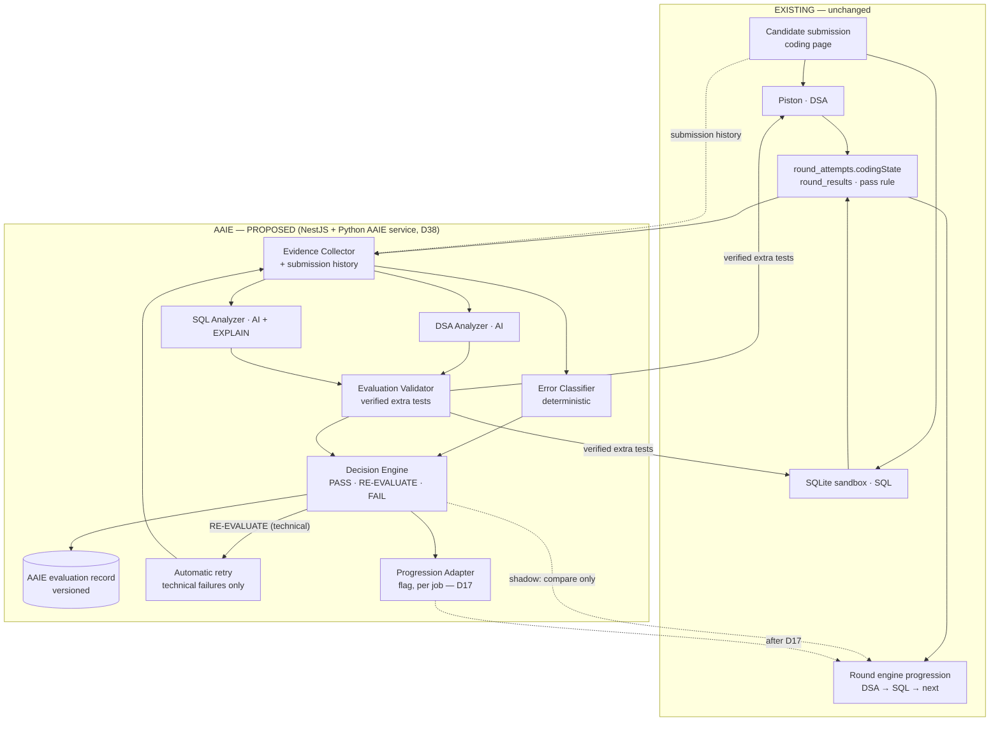

# AAIE — Adaptive DSA + SQL Evaluation Pipeline

| | |
|---|---|
| **Status** | **Proposal — NOT implemented.** No code, table, prompt or endpoint exists for this pipeline. |
| **Status note (2026-11-16)** | `workers/aaie-worker` now exists as a **shadow / advisory** service (DSA logic band endpoint; no database, no marks, no PASS / FAIL). It is **not** part of official candidate scoring: marks and pass / fail come only from the code runner's test results (`DsaService.scoreOf` -> round engine `coding-round.ts` -> assessments grading), and `apps/api` never calls the worker. NestJS integration is postponed. |
| **Document version** | 0.14.0 |
| **Scope** | DSA and SQL coding rounds **only**. No GD, AI interview, voice screening, ranking, combined score or other AAIE features. |
| **Branch** | `develop` |
| **Related** | General AAIE architecture: `docs/AAIE/README.md` (currently on branch `changes/frontend`; merge before relying on it) |

Labels: **[EXISTS]** implemented today, verified in code · **[PROPOSED]** design only · **[DECISION NEEDED]** must be
approved before the phase that depends on it.

---

## Contents

1. [Objective](#1-objective)
2. [Decisions needed before any work (conflicts with approved AAIE decisions)](#2-decisions-needed-before-any-work)
3. [What exists today](#3-what-exists-today)
4. [The pipeline](#4-the-pipeline)
5. [DSA analyzer](#5-dsa-analyzer)
6. [SQL analyzer](#6-sql-analyzer)
7. [Error classification](#7-error-classification)
8. [Evaluation validator](#8-evaluation-validator)
9. [Adaptive decision engine](#9-adaptive-decision-engine)
10. [Automated progression](#10-automated-progression)
11. [Evaluation record and audit](#11-evaluation-record-and-audit)
12. [Architecture](#12-architecture)
13. [Data design proposal](#13-data-design-proposal-not-implemented)
14. [Safety rules](#14-safety-rules)
15. [Phases](#15-phases)
16. [Risks](#16-risks)
17. [Open questions](#17-open-questions)
18. [Version history](#18-version-history)

---

## 1. Objective

Evaluate how candidates solve DSA and SQL problems — not only whether hidden tests pass — so that:

- valid alternative approaches are recognised;
- correctness, edge cases and efficiency are understood;
- technical failures never count against a candidate;
- progression decisions are consistent and explainable;
- talented candidates are not eliminated because of a narrow test or an infrastructure fault.

---

## 2. Decisions needed before any work

This pipeline changes what AAIE was approved to be. The general AAIE architecture (`docs/AAIE/README.md`, decisions
D1–D14) defines AAIE as a **read-only intelligence layer** that never grades and never decides progression. This
pipeline makes AAIE an **evaluator with decision power for DSA / SQL**. These changes must be approved explicitly —
they are not decided by this document.

| # | Proposed decision | Conflicts with | Notes |
|---|---|---|---|
| **D15** | AAIE's first scope is DSA + SQL rounds only | — | Narrows scope; no conflict |
| **D16** | For DSA / SQL, AAIE may produce its own PASS / RE-EVALUATE / FAIL decision (shadow first) | **D2** (AAIE never re-scores or re-grades; never changes pass / fail) | The original evaluator and its records stay untouched (§14); AAIE writes its own record |
| **D17** | For DSA / SQL, AAIE may drive progression after shadow validation | **D2**, **D5** (HR-only intelligence) | Only through the existing progression path, behind a feature flag, per job, with HR override kept (§10) |
| **D18** | AI analysis of candidate code and SQL (approach, complexity, edge cases, semantics) is allowed | **D9** (no AI code-quality analysis in release 1) | Shadow mode first; AI findings never decide on their own (§8, §9) |
| **D19** | Candidate code and queries may be sent to the existing AI worker (Gemini) | **D13 / B5** (privacy and consent verification) | Code is candidate data; consent and notice must cover it |
| **D20** | Ownership: this is evaluator work — AAIE module, or the planned M22 `evaluator` module (owner: Intern 2 (AI)) | D1, D2 (M22 owns scoring) | Must be agreed with the M22 owner to avoid two evaluators |

**Approved decisions for this pipeline**

| # | Decision | Status |
|---|---|---|
| **D21** | **The AI never suggests, makes or runs any fix to the candidate's code or query.** AAIE judges the submission exactly as the candidate submitted it. No corrected version is created, executed or shown to anyone. | **Approved** by the product owner on 2026-11-12 (this conversation) |
| **D15** | **AAIE's first scope is DSA + SQL rounds only.** | **Approved** by the product owner on 2026-11-12 (this conversation) |
| **D16** | **For DSA / SQL, AAIE produces its own marks and PASS / RE-EVALUATE / FAIL decision**, shadow first: during the shadow period AAIE's marks and decision are calculated and stored, while candidates still progress by today's rule. The original score and records stay untouched (§14); AAIE writes its own record. RE-EVALUATE is only for technical failures on Anvexa's side (runner / AI unavailable) and is retried automatically. | **Approved** by the product owner on 2026-11-12 (this conversation) |
| **D17** | **After the shadow period, AAIE's result drives progression for DSA / SQL** — through the existing progression path, behind a per-job feature flag, with HR's existing override kept and a switch back to today's rule (§10). | **Approved** by the product owner on 2026-11-12 (this conversation) |
| **D18** | **The AI analyses the candidate's code / query as submitted** (algorithm, logic, approach, complexity, SQL semantics) and its judgement of the logic is used for marks (D22). It never fixes the code (D21). | **Approved** by the product owner on 2026-11-12 (this conversation) |
| **D19** | **Candidate code and queries may be sent to the existing AI worker (Gemini).** Precondition kept: the candidate notice / consent wording must be checked (and updated if needed) to cover this before any code is sent — entry gate of Phase 2. | **Approved** by the product owner on 2026-11-12 (this conversation); privacy wording check **pending** |
| **D22** | **Fully automatic marks.** HR only sets each question's weight (marks) in the rounds editor; the round is scored out of the sum of the weights. Each question's weight is split **50 % logic / 50 % test cases**; no HR confirmation of marks (formula §9.1). | **Approved** by the product owner on 2026-11-12 (this conversation) |
| **D23** | **Graded logic marks, given directly by the AI.** The AI awards the logic part (`W / 2`) as a share from 0 to 100 %, judging **both logic and syntax** of the code as submitted (100 % right → full logic part; 70 % right → 70 % of it). **The same logic written with different syntax** (another language, different names, loops vs recursion, another style or structure) **gets the same marks.** No checklist / checkpoint method. | **Approved** 2026-11-12; **score part superseded by D29** (bands). Checkpoint approach **rejected** |
| **D24 (Q3)** | **Store every submission.** Each Run / Submit is kept with its timestamp, language (or SQL), code / query and its execution results; the best-performing submission is identified separately. AAIE never overwrites or deletes earlier submissions. *Clarification:* they are still erased with the application when a candidate or HR deletes it (existing data-protection erasure) — "never deleted" means never deleted by AAIE during evaluation. | **Approved** by the product owner on 2026-11-12 |
| **D25 (Q4)** | **Tag test cases by category:** normal, boundary, edge, duplicate values, NULL values (SQL), empty input, large input / performance. *Clarification:* tags explain where a solution struggles; they do not change the marks formula (test-case part stays `W / 2 × passed / total`, D22). Untagged tests count as "normal". | **Approved** by the product owner on 2026-11-12 |
| **D26 (Q5)** | **Switch-on gates after shadow mode** (benchmark of DSA and SQL questions incl. valid alternatives, incorrect submissions, technical failures): valid alternative solutions recognised ≥ 95 %; incorrect solutions passed = 0 in the benchmark; infrastructure errors classified correctly = 100 %; existing assessment regression tests = 100 % passing; tenant isolation tests = 100 % passing. Zero false passes in a finite set does not prove zero risk: monitoring continues after rollout. | **Approved** by the product owner on 2026-11-12 |
| **D27 (Q7)** | **Transparent technical-retry message** on the coding page, no candidate penalty (text in §10.1). The original submission is preserved, retried automatically within a configured limit, resumed when the service is back; if the retry cannot complete, the candidate is told with a clear next step. *Clarification:* the message says only that the evaluation is being retried — never marks, AI findings or reasons — so it stays within D3. | **Approved** by the product owner on 2026-11-12 |
| **D28** | **Responsibility boundary (§2a):** HR owns assessment design and standards — questions, marks / weights, round maximum marks, pass marks and criteria, round order and required rounds. AAIE owns intelligent evaluation and adaptive progression within that configuration and never modifies it. AAIE marks never exceed a question's configured marks; HR's pass criteria remain authoritative; the execution infrastructure (Piston, SQL engine, test execution, isolation) is unchanged. | **Approved** — architecture clarification of 2026-11-12 |
| **D20** | **Ownership: a separate AAIE module (not the M22 `evaluator` module).** Owned by the product owner approving this document; Intern 1 and Intern 3 may open and contribute to it. | **Approved** by the product owner on 2026-11-12 (this conversation) |
| **G1** (goal) | **No talented candidate is lost because tests failed on a small mistake** (e.g. a syntax error) when the algorithm and logic are right. | **Approved** goal, 2026-11-12 — achieved by the logic marks of D22 (§9.1) |

Unchanged and still binding: D3 (nothing candidate-facing from AAIE), D7 (no combined score, weights, rankings or
percentiles), D11 (no AI integrity judgments), and the rule that original evidence and results are never modified.

The proposed-decision table above is kept for history: **D15–D20 are now decided** (approved table above). D19's privacy
wording check remains an entry gate for Phase 2.

---

## 2a. Responsibility boundary: HR vs AAIE (D28)

**HR = Assessment Design and Standards. AAIE = Intelligent Evaluation and Adaptive Progression.**

| Responsibility | HR | AAIE | Execution modules (`dsa`, `sql`) | Round engine / assessments |
|---|---|---|---|---|
| Choose DSA / SQL questions per job | **Owns** | never changes | — | stores (rounds editor) |
| Question marks / weights, round maximum marks | **Owns** | reads only; never exceeds | — | stores |
| Pass marks and pass criteria (`passRule`) | **Owns** | reads only; applies as configured | — | stores, grades original result |
| Round order; which rounds candidates must complete; skipping rounds | **Owns** | never changes | — | stores, sequences |
| Execute code / queries (Piston, SQLite sandbox), isolation, limits | — | consumes outputs only | **Owns** (unchanged) | — |
| Per-test statuses, result comparison | — | consumes | **Owns** (unchanged) | — |
| Original result (`round_results`, `codingState`) | override (existing) | never overwrites | produces | **Owns** |
| Approach, alternatives, partial correctness, edge-case analysis, complexity, SQL semantics | — | **Owns** | — | — |
| Candidate vs infrastructure error classification | — | **Owns** (own record) | raw statuses | — |
| AAIE marks per question (within HR's weights) | — | **Owns** (versioned policy) | — | — |
| AAIE outcome PASS / RE-EVALUATE / FAIL | — | **Owns** | — | — |
| Progression (invites, links, emails) | override (existing) | supplies the decision (D17, pilot jobs only) | — | **Owns** the mechanism (idempotent, unchanged path) |
| HR override of a result | **Owns** (existing, wins over AAIE) | never blocks it | — | stores, audits |

AAIE never modifies HR's configuration (questions, marks, weights, maximum marks, pass marks, criteria, round order,
required rounds) and never rewrites Piston, the SQL engine, test execution or database isolation.

### 2b. Superseding decisions (approved 2026-11-12)

The architecture clarification of 2026-11-12 conflicted with D23 and §9.2 / D22. The product owner approved these
superseding decisions explicitly:

| # | Decision | Supersedes / amends | Status |
|---|---|---|---|
| **D29** | **Fixed, versioned logic rubric with five bands: 100 %, 75 %, 50 %, 25 %, 0 %.** The AI must place the submission in exactly one band using the DSA- or SQL-specific criteria of §9.3; no other value is possible. Every score includes supporting evidence (the lines / clauses of the submitted code) and reasoning. Rubric version recorded with every score. | **Supersedes D23** (AI-chosen 0–100 %). D23's other parts stay: AI judges the code as submitted, logic and syntax together; same logic in different syntax → same band; no per-question checkpoints. | **Approved** 2026-11-12 |
| **D30** | **Uncertain, invalid or inconsistent AI evidence → RE-EVALUATE, never automatic FAIL.** AAIE re-evaluates automatically up to a configured retry limit. When retries are exhausted, the case moves to **`HR_REVIEW_REQUIRED`**; HR resolves it through the existing override / review mechanism. No candidate is ever left silently held: every `HR_REVIEW_REQUIRED` case is visible to HR (§9.2). | **Amends §9.2 / D16** (RE-EVALUATE was technical-only) and **D22** (no HR role in marks) — HR is involved only in this exception path; normal marking stays fully automatic. | **Approved with clarification** 2026-11-12 |
| **D29 clarification** | **100 % requires a defect-free solution:** syntactically valid and logically correct for all valid inputs; any syntax / compile error rules out 100 %. Valid-but-less-efficient earns 75 % only if it stays valid within the problem's constraints. Multiple mistakes lower the band by a defect count (§9.3). | Clarifies D29 before first use (rubric still `logic-rubric-v1`; never applied yet) | **Approved** 2026-11-12 |
| **D32** | **The initial pilot excludes rounds whose pass rule is `CORRECT_COUNT`.** B9 stays unresolved; `CORRECT_COUNT` is not reinterpreted. Pilot jobs use `MARKS` or `PERCENTAGE` rounds. | — | **Approved** 2026-11-12 |
| **B3** | **Immutable, linked evidence versioning (§10.3).** Every submission and execution result stays traceable to its original assessment result and to every later AAIE evaluation; re-evaluations create new versions; existing records are never overwritten. | **Approved** by the product owner, 2026-11-12 |
| **D33** | **`FEATURE_AAIE_CODING`**: default **off**; enabled explicitly per pilot job and per environment; when disabled **no AAIE capture and no evaluation** happen; switching off restores existing behaviour exactly; every flag change is audited. | **Approved with conditions** by the product owner, 2026-11-12 |
| **D34** | **Test fixtures**: five categories for both DSA and SQL — correct, wrong answer, compile / syntax error, partial correctness, runner fault — including DSA boundary cases and SQL NULL, duplicate, JOIN and aggregation scenarios. | **Approved** by the product owner, 2026-11-12 |
| **D35** | **Duplicate protection, option (a)**: the candidate page generates one unique idempotency key per Run / Submit click; network retries reuse it; a deliberate new click gets a new key. Uniqueness is enforced in the database, scoped to the candidate's attempt. | **Approved** by the product owner, 2026-11-12 |
| **D36** | **One definition of a "counted submission" for reconciliation (§15 Phase 1, "Reconciliation").** Both sides of the comparison count the same thing: a **Submit** (never a Run) whose evaluation returned a result (any verdict, incl. compile error and `internal_error`) **and** whose progress update was persisted to `codingState` (`attempts` incremented). Refused requests (runner busy / down, finished or expired session, wrong language) and Submits that raced a finish (progress not saved) are not counted on either side. | Approved by the product owner, 2026-11-12 |
| **D37** | **Idempotent reconciliation.** Re-detecting the same missing capture never creates another technical-gap record: gap records have a database-unique identity and are append-only; resolution is a separate, equally unique record. | Approved by the product owner, 2026-11-12 |
| **D38** | **Technology for the DSA + SQL AAIE (§12a).** A dedicated **Python + FastAPI** AAIE evaluation service (proposed location `workers/aaie-worker/`) using the **Google Gemini API** to analyse submitted DSA code and SQL queries, with structured JSON output where supported; every AI response is validated with **Pydantic** schemas and deterministic rules; **Python calculates the logic marks from the D29 band** and the 50 % test-case + 50 % logic formula within HR's weights — Gemini never determines final marks or progression. Existing infrastructure is kept: NestJS (integration and orchestration), PostgreSQL / Neon (evidence, evaluation and outcome storage), Prisma (backend database access), Piston and the SQLite sandbox (execution, unchanged), Next.js (HR dashboard and candidate app). No LangGraph, multi-agent orchestration, queues or further services. **Amends** the placement in D19, §10.2 (A1), §12 and Phase 2: the AI calls move from the existing `workers/ai-worker` to the new AAIE service; D19's privacy gate is unchanged. | **APPROVED** by the product owner, 2026-11-12 |
| **D31 (B8)** | **Separate, versioned AAIE outcome record.** The original `round_results` is never overwritten or modified. Every consumer — round engine progression, the Assessments board, Stage 2 rules, PI calculations — distinguishes the **original assessment result** from the **effective outcome** (§10.0). **HR overrides always take priority.** | Resolves blocker **B8** | **Approved** 2026-11-12 |

**Not decided (B9):** `CORRECT_COUNT` pass rules are **not** reinterpreted to include partially solved questions.
Until an explicit decision, AAIE does not change how `CORRECT_COUNT` rounds are judged (§17).

## 3. What exists today

All verified on `develop`.

| Area | Today [EXISTS] | Where |
|---|---|---|
| DSA execution | Piston runs candidate code; per test case status: `passed`, `wrong_answer`, `runtime_error`, `time_limit`, `compile_error`, `internal_error` | `apps/api/src/modules/dsa/evaluation/evaluator.ts`, `dsa/execution/*` |
| Runner outages | Piston unavailable / busy → the request is refused (503 "try again"); nothing is recorded. A submission whose cases are all `internal_error` never becomes the best submission | `dsa/dsa.service.ts` |
| SQL execution | Node's built-in SQLite (`node:sqlite`) in an isolated worker with an authorizer (read-only, limits, time-out) | `apps/api/src/modules/sql/engine/sql-sandbox.ts`, `worker-source.ts` |
| SQL comparison | Tables, not text: column count and names, every value (number tolerance, NULL only equals NULL, number ≠ text), **duplicate rows count**, row order only when the question requires `ORDER BY` | `sql/engine/compare.ts` |
| Hidden tests | Test cases and SQL datasets marked hidden; the candidate never sees their input / output | `dsa/questions/*`, `sql/bank/*` |
| Scoring | Marks per problem = marks × passed / total; best submission kept per problem | `dsa/dsa.service.ts` |
| Stored evidence | Per problem: **best** submission's code, best score, passed / total, number of submissions, language, last verdict. **Earlier submissions are not stored.** | `round_attempts.codingState`, copied into `round_results.answers` (`round-engine/coding-round.ts`) |
| Pass / fail | The round's pass rule (e.g. marks ≥ pass mark) in the `assessments` module; HR can override with a reason | `assessments/grading.ts`, `round_results` |
| Progression | Finishing grades the attempt and queues the next step once; DSA → SQL continues on the coding page (`continueAfterCoding`) | `round-engine/round-engine.service.ts` |
| Test authoring with verification | AI-written problems: test outputs are checked by running a reference solution | `dsa/authoring/coding-author.service.ts` |
| AI worker | One Python FastAPI service (Gemini) with versioned prompts | `workers/ai-worker` |

What does **not** exist: approach recognition, complexity analysis, semantic SQL analysis, query plans, per-submission
history, a RE-EVALUATE state, an AAIE evaluation record.

---

## 4. The pipeline

```
1. Candidate submission           DSA code / SQL query                         [EXISTS]
2. Existing execution engine      Piston (DSA) · SQLite sandbox (SQL)          [EXISTS]
3. Evidence collection            submission · tests · results · question ·    [PROPOSED]
                                  submission history (history: new, §13)
4. AAIE intelligence layer        DSA analyzer · SQL analyzer ·                 [PROPOSED]
                                  error classification
5. Evaluation validator           AI findings checked against execution         [PROPOSED]
                                  evidence and verified extra tests
6. Adaptive decision engine       PASS · RE-EVALUATE · FAIL                     [PROPOSED, D16]
7. Automated progression          DSA PASS → SQL link                           [EXISTS today via pass rule;
                                                                                 AAIE-driven = D17]
8. Final evaluation record        decision · evidence · explanation ·           [PROPOSED]
                                  policy version · audit trail
```

Stages 1–2 are unchanged. AAIE starts at stage 3 and never alters what stages 1–2 recorded.

---

## 5. DSA analyzer

| Step | What | How | Deterministic? |
|---|---|---|---|
| 1. Receive code | question, language, submission, submission version | from the evidence collector (§13 submission history) | yes |
| 2. Compile and run | existing Piston path | **reuse existing results**; no second run unless the validator asks (§8) | yes |
| 3. Test-case analysis | passed / failed per sample, hidden, edge case | existing per-case statuses; edge cases need a per-test `kind` tag (new metadata on problems) | yes |
| 4. Algorithm recognition | brute force, HashMap, sorting, two pointers, DP, … | AI worker, structured output | **no — AI** |
| 5. Alternative solution validation | is a different approach valid? | correctness is proven by tests, never by AI opinion; AI only explains why an approach differs | AI + tests |
| 6. Complexity analysis | time / space estimate vs constraints | AI estimate, **cross-checked empirically** (timings on growing inputs, §8) before it is used | AI + measured |
| 7. Error classification | logic vs implementation vs technical | deterministic from statuses first (§7); AI adds a hypothesis for logic errors | mixed |
| 8. Validated DSA evaluation | structured evidence | to the validator, then the decision engine | — |

---

## 6. SQL analyzer

| Step | What | How | Deterministic? |
|---|---|---|---|
| 1. Receive query | query, question, schema | evidence collector | yes |
| 2. Syntax and safety | allowed statements, limits | **existing sandbox authorizer** (already enforces read-only, limits) | yes |
| 3. Execute | existing SQLite sandbox | reuse existing results | yes |
| 4. Compare results | actual vs expected | **existing `compare.ts`** (NULLs, duplicates, ordering already handled) | yes |
| 5. Semantic analysis | JOIN / subquery / CTE / EXISTS / IN equivalence | AI explanation; equivalence is **proven by results on all datasets**, not by AI | AI + results |
| 6. Edge cases | NULLs, duplicates, empty results, ordering | hidden datasets designed for these; tag each dataset with the edge case it covers | yes |
| 7. Efficiency | query plan, cost | `EXPLAIN QUERY PLAN` in the same SQLite sandbox. Datasets are tiny, so this is an **observation only**, never a reason to fail | yes (observation) |
| 8. Validated SQL evaluation | structured evidence | to the validator, then the decision engine | — |

---

## 7. Error classification

Deterministic first, from existing statuses:

| Signal | Class | Candidate penalty? |
|---|---|---|
| `compile_error` | Implementation error (candidate) | per pass rule |
| `runtime_error` | Implementation error (candidate) | per pass rule |
| `wrong_answer` | Correctness failure | per pass rule |
| `time_limit` | Efficiency / correctness failure — **unless** the runner was overloaded (validator re-runs, §8) | per pass rule after validation |
| `internal_error` | **Technical failure** | **never** |
| Piston unavailable / busy | **Technical failure** (already refused, nothing recorded) | **never** |
| SQL sandbox failure / setup problem | **Technical failure** (already reported as a setup problem, not the candidate's error) | **never** |
| AI analysis unavailable | **Technical failure** of AAIE | **never**; deterministic decision if sufficient, else RE-EVALUATE |
| AI and execution evidence disagree | Handled by §9.1: the test-case part always comes from execution; if all tests pass, full marks regardless of the AI | never lowers marks below what execution earned |

---

## 8. Evaluation validator

Rules — every AI finding must be checked against execution evidence before the decision engine may use it:

1. **Correctness comes only from execution.** AI may explain, never certify, correctness.
2. **No extra tests count toward marks.** The test-case part uses only the question's own tests (D22). AI-invented
   tests or expected outputs are never used.
3. **Complexity claims are measured.** An AI complexity estimate is used only when consistent with timings on growing
   inputs; otherwise it is recorded as "unverified" and ignored by the decision engine.
4. **Time-outs are re-checked.** A `time_limit` result is re-run once when the runner reports load; a pass on re-run
   is recorded with both results.
5. **AI vs tests.** The test-case part always comes from execution and is never changed by the AI. AI says "logic
   correct" while tests fail → logic part given (§9.1, D22). AI says "logic wrong" while all tests pass → execution
   wins, full marks.
6. **Every finding carries references** to the evidence it was checked against (submission version, test ids,
   dataset ids, run ids).

---

## 9. Adaptive decision engine

Shared by DSA and SQL. **No HR confirmation of marks** (D22): the algorithm calculates the marks and the decision.
No arbitrary AI confidence threshold and no universal test-case percentage: it applies HR's question weights, the
round's pass mark and the evidence.

### 9.1 Marks per question (D22)

For a question with weight **W** set by HR (logic part `L = W / 2`, test-case part `T = W / 2`):

| Situation | Logic marks | Test-case marks |
|---|---|---|
| All tests pass | `L` (execution proves the logic) | `T` |
| Some tests fail | `L × logic band` (100 / 75 / 50 / 25 / 0 %, D29) | `T × passed / total` |
| No output at all (e.g. compile error from a small mistake) | `L × logic band` (D29) | `0` |
| Not attempted | `0` | `0` |

`question marks = logic marks + test-case marks` · `round total = Σ question marks` (out of `Σ W`).

Examples — two questions of 15 (total 30), or one question of 40 (total 40):

| Answer (W = 15) | Logic (7.5) | Tests (7.5) | Marks |
|---|---|---|---|
| All tests pass | 7.5 | 7.5 | **15** |
| Logic correct, one syntax slip, no output (band 75 %, D29) | 5.63 | 0 | **5.63** |
| Logic correct, 6 of 10 tests pass | 7.5 | 4.5 | **12** |
| Logic wrong, 3 of 10 tests pass | 0 | 2.25 | **2.25** |

Rules:

- The **test-case part comes only from execution** (Piston / SQLite sandbox). The AI never changes it.
- The **logic part comes from the AI's analysis of the code exactly as submitted** (D18); it never fixes, runs or shows
  corrected code (D21). Every logic mark is stored with the AI's reasoning and the evidence references (§11).
- If all tests pass, the logic part is given without asking the AI (execution already proves it).
- Same formula for DSA programs and SQL queries.
- **Logic band (D29):** the AI judges logic and syntax together and places the submission in one band of §9.3, with
  evidence and reasoning. Equivalent logic in different syntax (language, names, loops vs recursion, style) must get
  the same band.
- Example (W = 15, L = 7.5): perfect logic but one syntax slip, no output → band 75 % → 5.63 (5.625 rounded to 2 decimals); band 100 % applies only to defect-free code;
  band 75 %, 4 of 10 tests → 5.63 + 3 = 8.63. Question marks are capped at W.
- **Consistency (implementation, no extra decision):** the same prompt and model version for every candidate of a round,
  deterministic settings (e.g. temperature 0), the score and reasoning stored with the policy version; the shadow
  period (§15 Phase 5) checks that equivalent solutions get the same score before D17 is switched on.

### 9.2 Decision

| Decision | Condition | Action |
|---|---|---|
| **PASS** | round total ≥ the round's pass mark | next round (once D17 is enabled per job; shadow: recorded only) |
| **FAIL** | round total < pass mark, with no technical failure involved | stop (once D17 is enabled; shadow: recorded only) |
| **RE-EVALUATE** | a technical failure on Anvexa's side (runner / sandbox error, AI unavailable), **or** uncertain, invalid or inconsistent AI evidence (D30) | automatic re-evaluation with back-off up to the retry limit; progression held; **never FAIL** |
| **HR_REVIEW_REQUIRED** | RE-EVALUATE retries exhausted (D30) | shown to HR on the Assessments board with the evidence collected; HR resolves through the existing override / review; the candidate sees the D27 "cannot complete" message with a next step; never silently held |

Hard rules:

- A technical failure never lowers a candidate's marks and never produces FAIL.
- If the AI judges the logic **wrong** but **all tests pass**, execution wins: full marks.
- If the AI output is invalid (missing reasoning, unreadable, contradicts the code it was given), it is retried; it is
  never guessed.
- Every decision stores its **policy version**: the split (50 / 50), prompt version, model.
- HR's existing override still exists afterwards for disputes; it is not a confirmation step.
- The original score (tests only) is never modified; AAIE's marks are stored next to it.

### 9.3 Logic rubric v1 (D29)

Rules for both DSA and SQL:

- **Counting defects (D29 clarification).** A *defect* is one distinct mistake at one place; the same mistake repeated
  (e.g. one misspelt name used five times) counts once. *Minor* defects: one syntax / compile-level slip, one minor logic
  or semantic slip, or (DSA) valid-but-less-efficient within the constraints. *Significant* gaps are listed in the
  50 % row. Band by count: **0 defects → 100 %** · **exactly 1 minor → 75 %** · **2–3 minor, or 1 significant → 50 %** ·
  **more than 3 minor, or more than 1 significant, or an approach that cannot solve the problem → 25 %** · wrong,
  irrelevant, empty, starter or hard-coded → 0 %. Any syntax / compile error rules out 100 %.
- Exactly one band per question: **100 %, 75 %, 50 %, 25 % or 0 %**. Choose the highest band whose description fully
  applies.
- Judge the code / query **exactly as submitted** (D21), logic and syntax together; never by output alone.
- Same logic in different syntax (language, names, loops vs recursion, JOIN vs subquery vs CTE, style) → same band.
- Every band comes with **evidence** (the lines or clauses it rests on) and **reasoning**. A band without evidence, or
  evidence that does not match the submitted code, is invalid → RE-EVALUATE (D30).
- If all tests pass, the band is 100 % without asking the AI (§9.1).
- Rubric version `logic-rubric-v1`, stored with every score; a changed rubric is a new version.

**DSA (programs)**

| Band | Criteria |
|---|---|
| **100 %** | **No defect.** The code is syntactically valid and logically correct for **all valid inputs** within the stated constraints, handles the edge cases the problem names, and meets the expected efficiency. **A submission with any syntax / compile error never qualifies for 100 %.** |
| **75 %** | **Exactly one minor defect**: one syntax / compile-level slip (e.g. a missing bracket, a misspelt name) with otherwise correct logic, **or** one minor logic slip a small local change would fix (off-by-one, wrong comparison operator, one missed boundary or edge case, wrong initial value), **or** a correct algorithm that is less efficient than expected **but still valid within the problem's constraints** (it would finish within the limits for the largest allowed input). |
| **50 %** | Right overall approach or data structure, with **two or three minor defects**, **or one significant gap**: a whole class of edge cases unhandled, incorrect state updates, a step missing or only partly implemented, or an algorithm whose complexity **exceeds** the problem's constraints. |
| **25 %** | **Partially relevant**: meaningful steps toward the solution (e.g. correct input handling, a correct sub-idea) but the approach cannot solve the problem as stated, **or** more than three minor defects, **or** more than one significant gap. |
| **0 %** | Wrong or irrelevant approach, empty submission, unchanged starter code, or hard-coded outputs. |

**SQL (queries)**

| Band | Criteria |
|---|---|
| **100 %** | **No defect.** The query is syntactically valid and returns the required result for **all valid data**: correct tables, joins and join conditions, filters, grouping and aggregation, NULL and duplicate semantics, and ordering when required. **A query with any syntax error never qualifies for 100 %.** |
| **75 %** | **Exactly one minor defect**: one syntax-level slip (a missing comma, a misspelt keyword or alias) with otherwise correct logic, **or** one minor semantic slip (a join type that drops or keeps NULL-side rows wrongly, a missing `DISTINCT`, a boundary filter `>` vs `>=`, NULL handling wrong in one place, missing ordering when required). |
| **50 %** | Right tables and general idea with **two or three minor defects**, **or one significant gap**: a missing join condition, the wrong grouping level, a missing required filter or aggregation step. |
| **25 %** | **Partially relevant**: uses the right tables but does not compute the required result, **or** more than three minor defects, **or** more than one significant gap. |
| **0 %** | Wrong or irrelevant query, empty submission, unchanged starter query, or hard-coded values. |

SQL efficiency (query plans) stays an observation only and does not change the band (datasets are small).

## 10. Automated progression

Today [EXISTS]: the round engine grades the attempt with the pass rule and queues the next step; DSA → SQL continues on
the coding page.

Proposed [D17, after shadow validation]:

- AAIE never sends invitations or writes round results itself. It hands its decision to the **existing** progression
  path through a single, owner-approved integration point in `round-engine` (a "progression adapter").
- Enabled per job behind a feature flag; off = today's behaviour exactly.
- RE-EVALUATE holds progression (like today's integrity review) until resolved or decided by HR.
- Rollback: switching the flag off returns every job to the existing pass-rule progression.

---

### 10.0 Integration design (outcome model decided by D31; implementation needs owner agreement under B1)

Based on the Phase 0 audit (§3 and the audit notes in the version history):

1. **Original path unchanged.** Finishing still runs `finish()` → `progress()` → `assessments.record()`; the original
   result is recorded exactly as today.
2. **Hold, for pilot jobs only.** In `RoundEngineService.progress()`, before `claimProgress()` — beside the existing
   integrity hold — progression waits while the job has AAIE enabled and the attempt has no final AAIE outcome. Nothing
   is queued yet, so no invite, link or email can go out early (this also neutralises the 10-minute email fallback).
3. **Asynchronous AAIE evaluation.** An AAIE poller (existing polling-worker pattern, `SKIP LOCKED` claims) evaluates
   finished coding attempts; AI calls never run inside the candidate's request.
4. **Handover.** A single round-engine method applies AAIE's final outcome through the existing `nextFor()` /
   `applyStep()` path. `claimProgress()` keeps it idempotent; invites stay unique per application and round; DSA PASS →
   SQL continues on the page via the existing `continueAfterCoding()` / `continueInvite()`.
5. **RE-EVALUATE** keeps the hold (never FAIL); after the retry limit the case becomes `HR_REVIEW_REQUIRED` (D30). The page shows the D27 message while `continueAfterCoding()` returns
   `WAITING`.
6. **Separate traceability (D31, B8 decided).** The original result stays in `round_results`, never modified; AAIE's
   marks and outcome live in a separate, versioned AAIE outcome record. Every consumer — round engine progression, the
   Assessments board, Stage 2 rules, PI calculations — uses the **effective outcome** and shows both:
   - **Effective outcome** = HR override if present → else, on AAIE pilot jobs, the final AAIE outcome → else the
     original result.
   - The board shows the original result and the AAIE outcome side by side, and marks which one is effective.
   - `HR_REVIEW_REQUIRED` cases are listed for HR (D30).
7. **HR override** (existing) always wins and is never blocked by AAIE.

### 10.0a `HR_REVIEW_REQUIRED` and the existing HR override — verified gap (D30)

Verified in code (`develop`):

| Existing capability | Where | Enough for D30? |
|---|---|---|
| HR override: pass / fail + reason (≥ 5 characters), audited `assessment.result_overridden` / `override_removed`, permission `jobs.write` | `AssessmentsService.override()` (`assessments/assessments.service.ts`), `PUT /assessments/applications/:applicationId/rounds/:roundId/override`, HR UI on the student review page | **Partly** — it records HR's decision on the original `round_results` row (HR's own action; AAIE still never writes there) |
| Override triggers progression | **No.** `override()` only saves and audits. Only `RoundEngineService.integrityDecision()` calls `override()` **and then** `progress()` | **No** |
| Retry of held attempts | `RoundEngineWorker.recover()` re-runs `progress()` every minute for unprogressed attempts (`unprogressedAttempts`, which already excludes integrity-review attempts) | Usable, if the AAIE hold treats an HR override as resolved |
| A list of cases waiting for HR | Only for integrity reviews; nothing for AAIE | **No** |
| Marks on override | Override is pass / fail only | AAIE marks for that question stay "unresolved"; the effective outcome follows HR |

**Workflow gaps to close (documented, not implemented):**

1. **Release:** the AAIE progression hold must treat an HR override as the resolution (effective outcome = HR
   override, D31) and progression must then run **once** — either an explicit "decide" call like
   `integrityDecision()` (preferred: immediate, audited) or `recover()` picking it up.
2. **Visibility:** an `HR_REVIEW_REQUIRED` list / badge on the Assessments board with the collected evidence, so no
   case is silently held; optional HR notification (channel to be agreed).
3. **Exclusion rule:** `unprogressedAttempts` must not keep re-running `progress()` for attempts waiting for HR, the
   same way it excludes integrity reviews.
4. **Candidate:** the D27 "cannot complete" message while the case waits for HR.

Owners: `round-engine` (1, 3), `assessments` and the HR dashboard (2), candidate app (4).

### 10.1 Candidate message during a technical retry (D27)

Shown on the coding page after the candidate finishes, while an evaluation is RE-EVALUATE because of a technical issue
on Anvexa's side:

> **Your submission is being verified**
>
> We encountered a temporary technical issue while evaluating your submission. Your submission has been safely saved.
> We are retrying the evaluation.
>
> *Rechecking your submission…*
>
> This will not negatively affect your assessment result. Please do not submit again unless instructed.

If the retry limit is reached: the candidate is informed (page and email) with a clear next step; the evaluation
stays RE-EVALUATE (never FAIL) and resumes when the service is available.

### 10.2 B1 — module owners and required interfaces / hooks

Owners as recorded in the repository (module README owner line; `.github/CODEOWNERS` user where present). No other
names are assumed.

| Module | Owner (README) | CODEOWNERS | Interface / hook | Kind | Needed from |
|---|---|---|---|---|---|
| `dsa` | "DSA assessment developer" | none | **H1** append-only submission capture after `DsaService.execute()` in `run()` and `submit()` (D24); failure must never block or fail the candidate | hook | Phase 1 |
| `dsa` / `sql` | "DSA assessment developer" / "SQL rounds" | none | **R1** question tests / SQL datasets with category tags (D25) — storage location to agree | read | Phase 1 (tags may default to "normal") |
| `round-engine` | Intern 3 (Candidate & Comms) | `GrisaPujara` | **R2** finished coding attempts: status, `codingState`, start / submit times, finish reason, integrity status | read | Phase 1 |
| `rounds-config` | Intern 1 (Core & HR) | `naina-chauhan` | **R3** `RoundsConfigService` — question weights, round max, `passRule`, order, skips | read (**exists**) | Phase 1 |
| `assessments` | **not listed — to confirm** | none | **R4** `AssessmentsService.resultsFor` — original result id + `updatedAt` | read (**exists**) | Phase 1 |
| AAIE service `workers/aaie-worker` (D38) | product owner (D20) | none yet (T11) | **A1** evaluation endpoint (rubric v1) | endpoint | Phase 2 (structure in Phase 1) |
| `round-engine` | Intern 3 (Candidate & Comms) | `GrisaPujara` | **H2** progression hold before `claimProgress()`; **H3** apply AAIE / HR outcome once; **H4** `unprogressedAttempts` exclusion | hook | Phase 6 |
| `assessments` + HR dashboard | not listed / Intern 1 | none / `naina-chauhan` | **H5** board shows original, AAIE and effective outcome; `HR_REVIEW_REQUIRED` list; override releases the hold | hook + UI | Phase 6 |
| `pipeline` | **not listed — to confirm** | none | **H6** Stage 2 rules and PI calculations read the effective outcome | hook | Phase 6 |
| candidate app | Intern 3 | `GrisaPujara` | **U1** D27 messages on `WAITING` / `HR_REVIEW_REQUIRED` | UI | Phase 6 |
| `prisma` schema (shared) | all three | all three | AAIE tables (§13) | schema review | Phase 1 |

**Agreement status of the Phase 1 interfaces (recorded 2026-11-12; full record in `ENGINEERING-DECISIONS.md`)**

| Module | Interface | Requirement | Owner of record (repository) | Agreeing developer | Agreement date | Status | Evidence link |
|---|---|---|---|---|---|---|---|
| `dsa` | **H1** | Capture every Run and Submit (non-blocking, idempotent: D35–D37) | "DSA assessment developer" (module README); no CODEOWNERS entry | not named | not stated | **Verbally confirmed** — reported by the product owner on 2026-11-12 | pending |
| `dsa` | **R1** | Provide test cases with categories (D25) | "DSA assessment developer"; no CODEOWNERS entry | not named | not stated | **Verbally confirmed** — reported 2026-11-12; *category storage still undecided (readiness row 6)* | pending |
| `sql` | **R1** | Provide SQL datasets with categories (D25) | "SQL rounds" (module README); no CODEOWNERS entry | not named | not stated | **Verbally confirmed** — reported 2026-11-12; *category storage still undecided (row 6)* | pending |
| `round-engine` | **R2** | Read access to finished coding attempts | Intern 3 (Candidate & Comms) (README); CODEOWNERS `GrisaPujara` | not named | not stated | **Verbally confirmed** — reported 2026-11-12 | pending |
| `rounds-config` | **R3** | Existing HR weights, pass rules and round order (`RoundsConfigService`, already exported) | Intern 1 (Core & HR) (README); CODEOWNERS `naina-chauhan` | not named | not stated | **Verbally confirmed** — reported 2026-11-12 | pending |
| `assessments` | **R4** | Access to original assessment results (`AssessmentsService.resultsFor`, already exported) | **not listed** in README or CODEOWNERS | not named | not stated | **Verbally confirmed** — reported 2026-11-12; *module owner still unidentified* | pending |

Phase 6 interfaces **H2, H3, H4, H5, H6** and **U1** are **future integration requirements** only — they are not part
of Phase 1 and are not covered by this agreement. The candidate-page idempotency key (D35) still needs the
candidate-app owner's agreement (readiness row 10). This agreement does not authorise implementation.

### 10.3 B3 — evidence-reference versioning and links

Every record is immutable once written; a change creates a new version, never an update in place.

```
Question version Q      roundQuestionId + questionHash
                        (SHA-256 of canonical JSON: weight W, kind, tests: id / expected / hidden / category, SQL spec)
                        stable: rounds are locked once results exist
        │
Submission S (D24)      id (UUIDv7) · attemptId · applicationId · tenantId · roundId · questionId · questionHash
                        kind RUN | SUBMIT · seq per question · language · codeHash (SHA-256) · code · submittedAt (server)
        │ 1:1
Execution result E      submissionId · per-test status / timeMs · compile output hash · engine version
                        (Piston language + version | node:sqlite + sandbox limits) · executedAt
        │
Original result link    round_results.id + round_results.updatedAt (version) · codingState entry hash of the best
                        submission · matched to S by codeHash
        │
AAIE evaluation V       id · version n (re-evaluation = new row; earlier ones kept, marked superseded)
                        per question: submissionId + codeHash + questionHash evaluated · test-case part ·
                        logic band + evidence spans (line ranges of S.code) + reasoning · rubricVersion ·
                        promptVersion · model · policyVersion (50 / 50 split) · validator result · status
        │
AAIE outcome O          attemptId · evaluation ids · round total / Σ W · passRule hash (snapshot) ·
                        decision PASS | RE-EVALUATE | FAIL | HR_REVIEW_REQUIRED · originalResultRef (id + updatedAt) ·
                        version
        │
Effective outcome       computed at read time, never stored as truth: HR override → AAIE outcome (pilot job) → original
```

Stale detection: `questionHash` mismatch → evaluation invalid (should not happen after lock); `round_results.updatedAt`
changed (e.g. HR override) → only the effective outcome is recomputed; a missing submission or result → evaluation
marked `MISSING_EVIDENCE` (technical, never a candidate failure).

Which submission AAIE evaluates per question: the one the original result used (existing best rule), linked by
`codeHash` — open question **Q14** whether to evaluate every submission and take the best AAIE marks.

## 11. Evaluation record and audit

Every AAIE evaluation produces one versioned record:

```
AAIE Evaluation Report (illustrative)
Assessment     DSA
Approach       HashMap                     (AI, explained — not used for correctness)
Test cases     9 / 10 passed               (execution)
Complexity     O(n)                        (AI estimate, measured: consistent)
Alternative    valid (all hidden tests on the different approach passed)
Implementation one edge case failed (empty input)
Decision       RE-EVALUATE
Reason         failed edge case; cause unclear → verified extra tests queued
Policy         dsa-sql-policy v1 · prompts v1 · model …
```

Audit: decision created / changed, re-evaluation, HR decision on RE-EVALUATE — ids and versions only, never code or
candidate data in audit metadata (audit rows survive erasure).

---

## 12. Architecture

Logical components in the existing NestJS API and **one** dedicated Python AAIE service (D38) — no other services,
queues or agents. (Before D38 the AI parts were planned inside the existing `workers/ai-worker`.)

| Component | Responsibility | Runs in |
|---|---|---|
| AAIE Orchestrator | Evaluation lifecycle (start, retry, states) | NestJS |
| Evidence capture | Captures every Run / Submit and its execution result (H1) | NestJS (`dsa` module hook) |
| Evidence loader | Loads the evidence for one evaluation | Python AAIE service (data path undecided, §12a) |
| DSA Analyzer | Logic band for DSA code (rubric v1, Gemini) | Python AAIE service |
| SQL Analyzer | Logic band for SQL queries (rubric v1, Gemini); plan observation from the existing sandbox | Python AAIE service |
| Error Classifier | Deterministic classification (§7) | Python AAIE service |
| Evaluation Validator | Pydantic schemas + deterministic rules on every AI response (no extra tests count, D22) | Python AAIE service |
| Scoring + Decision Engine | Marks (50 / 50 within HR's weights) and PASS / RE-EVALUATE / FAIL / HR_REVIEW_REQUIRED by HR's pass rule | Python AAIE service (pass-rule location undecided, §12a) |
| Progression Adapter | One integration point into existing progression (D17) | API (round-engine, owner-approved) |
| Audit & Provenance | Records, versions, evidence references | API + Postgres |



---

### 12a. Technology and service placement (D38)

**Approved technology (D38, APPROVED 2026-11-12)**

| Layer | Technology | Role |
|---|---|---|
| AAIE evaluation service | **Python + FastAPI** | evidence loading, error classification, Gemini analysis, validation, scoring, decision |
| AI model | **Google Gemini API** | analyses submitted code / queries and returns the D29 band with evidence and reasoning; structured JSON output where supported |
| Validation | **Pydantic** + deterministic rules | every AI response checked before use |
| Integration / orchestration | **NestJS** (existing) | triggers evaluations, applies outcomes to the existing round engine (Phase 6) |
| Storage | **PostgreSQL / Neon** (existing) | evidence, evaluations, outcomes |
| Database access | **Prisma** (existing, backend) | NestJS data access |
| Execution | **Piston**, **SQLite sandbox** (existing) | **unchanged** |
| UI | **Next.js** (existing) | HR dashboard, candidate app |

**Proposed initial service structure (proposal — not created)**

```
workers/aaie-worker/
    app/
        main.py
        api/
            evaluation.py
        services/
            evidence_loader.py
            error_classifier.py
            gemini_evaluator.py
            rubric_validator.py
            scoring_service.py
            decision_engine.py
        schemas/
            evaluation.py
        prompts/
            dsa_prompt.py
            sql_prompt.py
        config.py
    tests/
    requirements.txt
    README.md
```

**Intended evaluation flow**

1. Existing DSA / SQL execution completes (Piston / SQLite sandbox, unchanged).
2. Original assessment results stay preserved (`codingState`, `round_results`).
3. AAIE evidence capture stores the submission and its execution evidence (H1, D24, D35–D37).
4. The Python service loads the relevant evidence.
5. The error classifier separates candidate errors from infrastructure failures.
6. Gemini analyses the submitted code / query and its problem-solving logic (rubric v1, D29) — never fixing it.
7. Pydantic schemas and deterministic validators check the AI response (D30 on failure).
8. The Python scoring service calculates marks: 50 % test cases + 50 % logic, within HR's question weights (D22, D29).
9. The decision engine applies HR's existing pass criteria and produces the AAIE outcome.
10. The existing round engine handles progression once the integration phase (Phase 6) is reached.

**Boundaries (binding)**

- HR owns questions, weights, maximum marks, pass criteria and round order (D28).
- Piston and the SQLite sandbox are not modified.
- Gemini never generates replacement code or SQL fixes (D21) and never executes candidate code.
- AI confidence alone never determines marks; Python maps the validated band to marks.
- Original assessment results are never overwritten; evidence is immutable and versioned (B3, D31).
- Infrastructure failures never count against candidates.
- HR overrides always take priority.
- Phase 1 changes no existing execution, scoring or progression workflow.

**Not decided (must be decided before the phase that needs them — not invented here)**

| # | Open item | Needed by | Notes |
|---|---|---|---|
| T1 | Gemini model and version | Phase 2 | not chosen |
| T2 | Evidence data path: NestJS sends the evidence to the Python service, or the Python service reads Postgres directly | Phase 1–2 | affects B1 (module boundaries) and tenant isolation; Python has no Prisma |
| T3 | Which side writes AAIE evaluation and outcome records (NestJS / Prisma or Python) | Phase 1 | schema review (B6 / readiness row 5) |
| T4 | Where HR's pass rule is applied: Python decision engine, or the existing TypeScript `gradeResult()` | Phase 5 | two implementations of the same rule could diverge; must be decided explicitly |
| T5 | Retry configuration (limits, back-off), time-outs | Phase 2 | not chosen |
| T6 | Service-to-service authentication between NestJS and the Python service | Phase 1–2 | not chosen |
| T7 | Hosting / start-up (port, start scripts, container) for the new service | Phase 1 | existing workers run on 8000 / 8010 |
| T8 | Dependency management: `requirements.txt` (as proposed) vs `pyproject.toml` + `uv` (convention of `workers/ai-worker` and `workers/gd-agent`); Python version (existing workers: ≥ 3.12) | Phase 1 | |
| T9 | Prompt format: Python modules (as proposed) vs versioned YAML (convention in `workers/ai-worker/prompts`) | Phase 2 | prompt version must be recorded either way |
| T10 | Where reconciliation (D36, D37) runs: NestJS or Python | Phase 1 | |
| T11 | Ownership entry for `workers/aaie-worker/` in `.github/CODEOWNERS` (D20: product owner) | Phase 1 | |
| — | Database schema | Phase 1 | readiness row 5 (schema review) |

## 13. Data design proposal (not implemented)

[PROPOSED — schema review required]

| Table | Purpose |
|---|---|
| `aaie_coding_evaluations` | One row per attempt × policy version: decision, reasons, structured findings with evidence references, validator results, policy / prompt / model versions, status, shadow flag, the existing outcome at the time (for comparison) |
| `aaie_submission_evidence` | **Needed for "submission history"** (today only the best submission is stored): one row per Run / Submit — question, language, code or query hash + text, statuses per test, timings, verdict. Read-only copy for evaluation; deleted with the application |

Both: `tenant_id`, `application_id` FK with `ON DELETE CASCADE`, never written to by other modules, never written by
AAIE into other modules' tables.

Decided (D24): every submission is stored in `aaie_submission_evidence`; never overwritten or deleted by AAIE; erased with the application. Test-case category tags (D25) are stored with the question's tests.

---

## 14. Safety rules

- The original evaluator, its scores, `codingState`, `round_results`, overrides and progression are **never modified**
  by AAIE.
- Infrastructure failures never count against a candidate (§7).
- AI never decides PASS or FAIL on its own (§9).
- Shadow mode first: AAIE decisions are recorded and compared, **not acted on**, until the agreement benchmark (Phase 5)
  is met and D17 is approved.
- No candidate-facing output from AAIE (D3). No combined score, weights, rankings or percentiles (D7).
- No new microservices, queues, agents or infrastructure: existing API, AI worker, Piston, SQLite sandbox, Postgres.
- Feature flags: `FEATURE_AAIE_CODING` (off by default); progression per job (D17).
- Tenant isolation on every read and write; candidate code sent to the AI only after D19.

---

## 15. Phases

Every phase ends with: its tests passing, this README updated (sections + version history), and the product owner's
approval before the next phase starts. Until Phase 6, AAIE runs in **shadow**: it calculates and stores marks and
decisions, but candidates move on by today's rule (D16).

| Phase | Name | AI used | Status |
|---|---|---|---|
| 0 | Decisions + reading today's code | No | **In progress** — decisions done |
| 1 | Contracts, evidence, test-case marks (no AI) | No | Not started |
| 2 | DSA logic marks by AI (shadow) | Yes | Not started |
| 3 | SQL logic marks by AI (shadow) | Yes | Not started |
| 4 | Validator: checks every AI result | No | Not started |
| 5 | Marks + PASS / RE-EVALUATE / FAIL engine (shadow) and trial comparison | Uses Phase 2–4 | Not started |
| 6 | Switch on: AAIE moves candidates forward (per job) | — | Not started |
| 7 | Benchmarks, security, regression | — | Not started |
| 8 | Gradual rollout | — | Not started |

Every phase has the same three-part exit: **Success criteria** (what "working" means) · **Verify before moving on**
(tests and checks that must pass) · **Gate** (who approves). Regression is always included: existing DSA / SQL / round
engine / assessments suites must stay green, and original records must be unchanged.

### Phase 0 — Decisions + reading today's code

Steps: decisions D15–D32 recorded (**done**) · code audit (**done**, §3, §10.0a) · D19 wording check · M22 owner informed
· B1 owners confirmed · B3 approved · D25 tag storage agreed.

- **Success criteria:** every decision needed for Phase 1 is recorded; owners for `dsa`, `sql`, `assessments`,
  `pipeline` confirmed; B3 approved.
- **Verify before moving on:** the Phase 1 readiness checklist below is fully ticked; the docs (this README,
  `docs/AAIE/README.md`, `ENGINEERING-DECISIONS.md`) agree with each other.
- **Gate:** product owner approves "start Phase 1".

**Phase 1 readiness checklist** — status verified in the repository on 2026-11-12. An item is ticked only when its
evidence is recorded here (who, when, where); a statement in conversation is not evidence for owner approvals.

| # | Item | Required evidence | Status (2026-11-12) |
|---|---|---|---|
| 1 | D15–D32 recorded; D28 in the Cursor rule | this README §2, §2b; `.cursor/rules/aaie-docs.mdc` | **Done** |
| 2 | Phase 0 code audit | §3, §10.0a | **Done** |
| 3 | B1 Phase 1 subset: H1, R1 (`dsa`, `sql`), R2, R3, R4 agreed; owners of `dsa`, `sql`, `assessments` confirmed | developer name / role, date, link per interface in `ENGINEERING-DECISIONS.md` B1; owners of `dsa`, `sql`, `assessments` identified | **Partly done** — all six interfaces **verbally confirmed** (reported by the product owner 2026-11-12); developer names, agreement dates and evidence links **pending**; owners of `dsa`, `sql`, `assessments` **not yet identified**; CODEOWNERS unchanged |
| 4 | B3 versioning (§10.3) approved | product owner approval + date in `ENGINEERING-DECISIONS.md` B3 | **Done** — approved by the product owner 2026-11-12; recorded in §2b and `ENGINEERING-DECISIONS.md` B3 |
| 5 | Schema review of `aaie_submission_evidence`, `aaie_coding_evaluations`, AAIE outcome record | review by the shared `prisma` owners (CODEOWNERS for `apps/api/prisma/`: all three interns), recorded with date | **Not done** — no review recorded |
| 6 | D25 tag storage agreed (or start with every test "normal") | `dsa` / `sql` owner decision recorded | **Not done** |
| 7 | Feature flag `FEATURE_AAIE_CODING`, default off | product owner approval recorded | **Done** — D33, approved with conditions 2026-11-12 |
| 8 | Fixture set (correct, wrong, compile error, partial, runner fault — DSA and SQL) | list of fixtures agreed | **Done** — D34, approved 2026-11-12 |
| 9 | M22 `evaluator` owner informed (D20) | date and channel recorded | **Not done** |
| 10 | H1 capture idempotency key source agreed (§15 Phase 1, "Capture") | product owner choice; `dsa` + candidate-app owners' agreement to the change | **Option decided** — (a), D35, 2026-11-12. **Owner agreement for the page and `dsa` changes still pending** (part of row 3 / B1) |

Not needed for Phase 1: D19 wording (Phase 2), B9 (pilot excludes `CORRECT_COUNT`, D32), B10, Q14 (Phase 2).

**Still outstanding:** row 3 (written evidence, developer names and dates for the verbally confirmed B1 interfaces; owners of `dsa`, `sql`, `assessments`), row 5 (schema review), row 6 (category
storage), row 9 (M22 notification), row 10 owner agreement. **Phase 1 may start only when these are Done and the
product owner gives an explicit implementation go-ahead.**

### Phase 1 — Contracts, submission capture, test-case marks (no AI)

Steps: contracts · AAIE module skeleton behind the flag · H1 capture of every Run / Submit (D24) · R1–R4 reads ·
deterministic error classification (§7) · test-case half `W / 2 × passed / total` with runner faults excluded and
re-run · AAIE evaluation record (shadow) linked per §10.3.

**Phase 1 guarantees (binding).** Phase 1 cannot modify, and its tests must prove it does not modify:

- original marks (`codingState`, `round_results` marks and answers);
- pass / fail decisions (`systemPassed`, overrides, outcome emails);
- HR configuration (questions, weights, round maximum, pass marks and rules, round order, skips);
- candidate progression (invites, links, `progressedAt`, `continueAfterCoding`);
- execution workflows (Piston, SQLite sandbox, evaluator, test statuses, scoring, timer, proctoring).

The **only** code added inside an existing flow is the H1 capture call in `DsaService.run()` / `submit()`. It runs after
the result is computed, does not change the request, the response, the timing guard, the stored progress or any
error path, and is off when `FEATURE_AAIE_CODING` is off. Everything else in Phase 1 lives in the AAIE module and only
reads (R1–R4).

**Capture: non-blocking and idempotent (D35, D33).**

- *Does not change the result:* capture never alters the candidate's execution result, response, error path or timing
  guard; it runs after the result is computed.
- *Bounded:* the capture write has a short time-out and a bounded effort (no unbounded retries inside the request);
  errors are caught and logged without code or candidate data; the candidate's response is returned regardless.
- *Honest status:* capture success is reported only when the database write is committed. A failed or timed-out write
  is never reported as captured; it is a **technical gap**. Because a failed write may also fail to record the gap, the
  gap is made durable by **reconciliation** (below).
- *Capture records the counting facts:* each capture stores `kind` (RUN / SUBMIT), `evaluationCompleted` (a result was
  returned) and `progressPersisted` (the `codingState` update was saved). The Submit capture is therefore taken **after**
  the progress-save step, and still never changes the response.

**Reconciliation (D36, D37).**

- *Same definition on both sides (D36):* expected = `codingState.progress[question].attempts`; captured = captures with
  `kind = SUBMIT`, `evaluationCompleted = true`, `progressPersisted = true` for that attempt and question.
  - **Runs** are excluded from both sides (they are captured as evidence but never counted).
  - **Refused requests** never reach evaluation: not counted, not captured.
  - **Submits that raced a finish** (`progressPersisted = false`) are captured but excluded from the comparison.
  - **Older pages** (no client key) are captured with a server key and counted normally — the key source does not
    change the definition.
  - **Failed captures** are exactly what the comparison detects.
- *When it runs:* only for finished attempts (the counter is final) and after a grace period, so in-flight captures
  are not reported as missing.
- *Outcomes per attempt and question:*
  - expected = captured → consistent;
  - expected > captured → `MISSING_CAPTURE` gap(s), one per missing slot (slot k of n), technical, never a candidate
    issue;
  - expected < captured → `COUNTER_UNDERCOUNT`: the original counter lost an update (e.g. two simultaneous submits);
    recorded as a technical observation about the original record, not as missing evidence; the original record is not
    changed.
- *Idempotent (D37):* a gap's identity is `(tenant_id, attempt_id, question_id, gap_type, slot)`, enforced `UNIQUE` in
  the database; detection writes insert-if-absent, so running reconciliation again finds the same gap and creates
  nothing new. Gap records are append-only (B3). If a late capture later fills a slot, a resolution record with its
  own unique identity `(gap id)` is added — the gap record itself is never overwritten.
- *Idempotent (option a):* the candidate page generates a new random idempotency key (UUID) per Run / Submit click and
  sends it with the request; a network retry of the same click reuses it; a deliberate new click gets a new key. The
  database enforces `UNIQUE (tenant_id, attempt_id, capture_key)`, scoping the key to the candidate's attempt; the
  write is insert-if-absent, so a retried request never creates a second evidence record. The server validates the
  key's format; a request without a key (an older page) is still executed normally and captured with a server-generated
  key, marked "no client key".
- *Disabled:* with `FEATURE_AAIE_CODING` off for the job / environment, no capture and no evaluation happen (D33).
- *Flag control:* the environment flag is the global kill switch; pilot enablement is per job and every change is
  audited (who, when, job, on / off).

- **Success criteria:** every Run / Submit is captured with its execution result and links; test-case marks are
  correct for any HR weights; runner faults never lower AAIE marks; nothing visible to candidates or HR changes.
- **Verify before moving on:**
  - Capture completeness: submissions captured = submissions made (fixture runs and a shadow day on a real job).
  - A capture failure (database down) never fails or slows the candidate's run / submit (fault-injection test).
  - The same request delivered twice creates exactly one evidence record (idempotency test); two deliberate identical
    submissions create two.
  - Guarantee checks: before / after snapshots of `codingState`, `round_results`, round configuration, invites and
    progression are identical with the flag on and off.
  - Test-case marks match hand-calculated values for weights 15 + 15, 40, 7 + 8 + 25, DSA and SQL.
  - Fixtures (D34) cover all five categories for DSA and SQL, incl. DSA boundary cases and SQL NULL, duplicate, JOIN and
    aggregation scenarios.
  - Idempotency (D35): a retried click with the same key → one record; a new click → a new record.
  - Reconciliation (D36, D37): fixtures with Runs only, Submits only, a refused submit, a submit racing a finish, an
    older-page submit and an injected capture failure produce no false gaps and exactly the expected
    `MISSING_CAPTURE` / `COUNTER_UNDERCOUNT` records; running reconciliation twice creates no duplicates; a late capture
    adds a resolution record without changing the gap.
  - Flag (D33): off → no capture, no evaluation, no AAIE writes; flag changes appear in the audit log.
  - **Python service health and start-up (D38):**
    - the FastAPI service starts successfully and exposes a health endpoint;
    - NestJS → Python service connectivity is verified;
    - a Python service start-up failure never affects existing DSA / SQL execution (Run, Submit, Finish keep working);
    - no Gemini evaluation and no AI calls happen in Phase 1.
  - `internal_error` / runner-down cases classified as technical in 100 % of fixtures.
  - Original `codingState`, `round_results`, progression, emails and links byte-for-byte unchanged (regression suites).
  - Tenant isolation: another company's attempts are never read.
  - Flag off = zero AAIE writes.
- **Gate:** product owner approves; `dsa` owner confirms the capture hook is safe.

### Phase 2 — DSA logic band by AI (shadow)

Steps: A1 evaluation endpoint in the AAIE Python service (D38) · prompt implementing rubric v1 for DSA (§9.3) · no fix ever (D21) · fixed
settings and versions · band + evidence + reasoning stored · validator basics.

- **Success criteria:** every DSA submission in the trial gets exactly one band with evidence and reasoning; the
  same logic in different syntax gets the same band.
- **Verify before moving on:**
  - Benchmark per problem: defect-free solutions → 100 %; one syntax slip → 75 %; one minor logic slip → 75 %;
    valid-but-slower within constraints → 75 %; over-constraint brute force → 50 %; 2–3 minor defects → 50 %;
    irrelevant / empty / starter → 0 %.
  - Equivalence pairs (Python vs Java vs C++, loop vs recursion, renamed variables) → identical band.
  - Repeatability: the same submission evaluated several times → same band every time.
  - No output ever contains corrected code (automated check).
  - Prompt-injection samples inside code are ignored.
  - AI unavailable → RE-EVALUATE, never a lower mark.
  - **Python service unavailable (D38) — applies to Phases 2, 3 and 4:**
    - service downtime results in RE-EVALUATE, never lower marks or FAIL;
    - original assessment results remain unchanged;
    - after recovery, pending evaluations resume safely;
    - duplicate evaluation records are prevented;
    - after the permitted retries, unresolved cases move to `HR_REVIEW_REQUIRED` (D30).
  - D19 wording check completed before the first real candidate's code is sent.
- **Gate:** product owner reviews the benchmark report.

### Phase 3 — SQL logic band by AI (shadow)

Same steps as Phase 2 for SQL (§9.3 SQL criteria); query plan stored as an observation only.

- **Success criteria / verify:** as Phase 2, plus equivalence pairs JOIN vs subquery vs CTE vs EXISTS / IN → same
  band; NULL / duplicate / ordering slips land in 75 %; a missing join condition lands in 50 %. Includes the D38
  "Python service unavailable" checks (Phase 2).
- **Gate:** product owner reviews the SQL benchmark report.

### Phase 4 — Validator

Steps: band is one of five values · evidence spans exist in the submitted code · reasoning present · all tests pass →
100 % · test-case part never touched by the AI · invalid → RE-EVALUATE with retry limit → `HR_REVIEW_REQUIRED` (D30).

- **Success criteria:** no unvalidated AI result is ever used for marks.
- **Verify before moving on:** fuzzed / malformed AI outputs (missing band, invented line numbers, a band like 80 %,
  corrected code in the reply) are all rejected; retry limit reached → `HR_REVIEW_REQUIRED`, never FAIL; the D38
  "Python service unavailable" checks (Phase 2) pass for the validator path too.
- **Gate:** product owner approves.

### Phase 5 — Marks + outcome engine (shadow) and trial

Steps: question marks = logic part + test-case part (≤ W) · round total vs HR's pass rule (`MARKS` / `PERCENTAGE`
only, D32) · PASS / RE-EVALUATE / FAIL / `HR_REVIEW_REQUIRED` · AAIE outcome record (§10.3) · shadow trial on real
rounds with a difference report against the original results.

- **Success criteria:** the D26 gates — valid alternatives recognised ≥ 95 %; incorrect solutions passed = 0 in the
  benchmark; infrastructure errors classified 100 %; regression 100 %; tenant isolation 100 %.
- **Verify before moving on:** every difference between AAIE and the original outcome is listed with its reason; no
  technical failure produced FAIL; no AAIE mark exceeds W; HR's pass rule applied unchanged (`maxScore` scaling
  included); `CORRECT_COUNT` rounds skipped (D32).
- **Gate:** product owner signs off the trial report.

### Phase 6 — Switch on per pilot job (D17)

Steps: H2 hold · H3 apply outcome once · H4 exclusion · H5 board + `HR_REVIEW_REQUIRED` list + override release ·
H6 Stage 2 / PI read the effective outcome · U1 candidate messages · per-job flag.

- **Success criteria:** on a pilot job, AAIE's effective outcome drives progression exactly once; flag off = today.
- **Verify before moving on:**
  - DSA PASS → SQL opens on the page; FAIL → today's rejection path; RE-EVALUATE holds with the D27 message.
  - Exactly one invite / link / email per candidate per round, also under retries and two API instances.
  - HR override releases a held or `HR_REVIEW_REQUIRED` case once and wins over AAIE.
  - Board, Stage 2 and PI all show the same effective outcome; the original result is still visible and unchanged.
  - Switching the flag off mid-pilot returns the job to today's behaviour without losing records.
- **Gate:** product owner + `round-engine`, `assessments`, `pipeline` owners approve.

### Phase 7 — Benchmarks, security, regression

- **Success criteria:** full benchmark, security and regression suites green.
- **Verify before moving on:** prompt injection, data leakage (no candidate code in logs), tenant isolation,
  concurrency (simultaneous submits), runner / AI outage drills.
- **Gate:** product owner approves rollout.

### Phase 8 — Gradual rollout

One pilot job → a few jobs → default for new `MARKS` / `PERCENTAGE` DSA and SQL rounds.

- **Success criteria:** stable over each step: no unexplained differences, `HR_REVIEW_REQUIRED` rate acceptable, no
  duplicate progression, no candidate complaints traced to infrastructure.
- **Verify at each step:** daily difference report, retry / review rates, monitoring alerts; ready rollback (flag off).
- **Gate:** product owner approves each widening step.

## 16. Risks

| Risk | Mitigation |
|---|---|
| AI judges an incorrect solution as valid | correctness only from execution; conflicts → RE-EVALUATE |
| AI-generated extra tests are wrong | expected outputs only from the reference solution on the real runner |
| Complexity estimates are wrong | measured timings; unverified estimates ignored |
| Runner load causes false time-outs | re-run on load; infra never penalised |
| SQL efficiency meaningless on tiny datasets | observation only |
| Two evaluators (AAIE and M22) | D20 ownership decision |
| Prompt injection inside candidate code / queries | treated as untrusted data; structured output; validator |
| Privacy of code sent to Gemini | D19 consent / notice; minimal data (no names) |
| Progression regressions | shadow first, per-job flag, rollback, regression suite |

---

## 17. Open questions

- **Q1.** Approve D15–D20 (§2)? Especially D16 / D17 (AAIE decides and drives progression for DSA / SQL).
- **Q2.** Owner of this work: AAIE module or M22 `evaluator` (D20)?
- **Q3.** Answered by D24: store every submission.
- **Q4.** Answered by D25: tag tests by category. Still to agree with the problem-bank owners (`dsa`, `sql`): where the tag is stored and who tags existing questions.
- **Q5.** Answered by D26: switch-on gates.
- **Q6.** ~~Who works the HR review queue~~ — answered by D22: no HR review queue for marks.
- **Q7.** Answered by D27: transparent technical-retry message (§10.1).
- **Q8–Q12.** Answered by D22: logic marks whenever the logic is correct (no separate "small mistake" definition);
  fully automatic; marks = logic + test-case marks; they count toward the round total and pass mark; same for SQL.
- **Q13.** Answered by D23 / D29: efficiency is part of the logic band.
- **Q14 (OPEN — decide in Phase 2).** Which submission AAIE evaluates: only the one the original result used (current
  design), or every submission with the best AAIE marks kept? **The evaluation policy must distinguish Run captures
  (sample tests only, practice) from final Submit captures (all tests, scored), and must state explicitly which
  submissions can influence final AAIE marks.** Until decided: Run captures are evidence only and never influence marks;
  only Submit captures are candidates for scoring.

### Blockers found by the Phase 0 audit (also in `docs/AAIE/README.md` §13)

- **B8 — Decision handover: DECIDED (D31).** Separate, versioned AAIE outcome record; `round_results` never modified;
  every consumer uses the effective outcome (§10.0 item 6). **Remaining work (OPEN under B1):** the owners of
  `round-engine`, `assessments` (Assessments board) and `pipeline` (Stage 2 rules, PI calculations) must agree to read
  the effective outcome.
- **B9 — `CORRECT_COUNT` pass rules: OPEN (unresolved design decision).** `CORRECT_COUNT` is **not** reinterpreted to
  include partially solved questions. Options for a later decision: (a) keep "solved = all tests pass" for this mode
  (AAIE marks shown, not used for the outcome); (b) exclude `CORRECT_COUNT` rounds from AAIE pilot jobs; (c) another
  explicitly approved rule. Until decided, AAIE pilot jobs should use `MARKS` or `PERCENTAGE` rounds. Owners:
  `assessments`, product owner.
- **B10 — Partial runner faults.** Today a submission with *some* `internal_error` cases counts them as failed
  (`marks × passed / total`). AAIE's own marks will exclude them and re-run (RE-EVALUATE); whether the original
  scoring is also fixed is for the `dsa` owner.

---

## 18. Version history

| Version | Date | Change |
|---|---|---|
| 0.1.0 | 2026-11-12 | First version: the shared DSA + SQL pipeline written up against the verified `develop` code; conflicts with D2, D5, D9, D13 recorded as decisions D15–D20 (not approved); phases 0–8. |
| 0.14.0 | 2026-11-12 | §15: added D38 checks — Phase 1 "Python service health and start-up" (health endpoint, NestJS connectivity, start-up failure never affects DSA / SQL execution, no AI calls in Phase 1); Phases 2–4 "Python service unavailable" (RE-EVALUATE, originals unchanged, safe resume, no duplicate evaluations, `HR_REVIEW_REQUIRED` after retries), cross-referenced from Phases 3 and 4. Existing criteria, checks and gates unchanged. |
| 0.13.0 | 2026-11-12 | B1 Phase 1 interfaces (H1, R1 DSA, R1 SQL, R2, R3, R4) recorded as **verbally confirmed** (reported by the product owner); developer names, dates and evidence links pending; H2–H6 and U1 kept as Phase 6 future requirements. Readiness row 3 → partly done. CODEOWNERS unchanged. |
| 0.12.0 | 2026-11-12 | **D38 APPROVED**: Python + FastAPI AAIE service with Gemini (structured JSON), Pydantic + deterministic validation, Python-computed marks; existing NestJS / Postgres / Prisma / Piston / SQLite sandbox / Next.js kept; no LangGraph, multi-agent, queues or extra services. Added §12a (approved stack, proposed service structure, flow, boundaries, undecided items T1–T11); §12 placement and §10.2 A1 updated; D19 / Phase 2 placement amended (existing ai-worker → AAIE service). Nothing implemented. |
| 0.11.0 | 2026-11-12 | **D36** one "counted submission" definition for reconciliation (Submit with completed evaluation and persisted progress; Runs, refused requests and finish-raced submits excluded on both sides); **D37** idempotent reconciliation (unique gap identity, append-only gaps, separate resolution records). Capture now records kind / evaluationCompleted / progressPersisted; reconciliation section and Phase 1 checks added. |
| 0.10.0 | 2026-11-12 | Product owner decisions recorded: **B3 approved**; **D33** feature flag (default off, per pilot job / environment, no capture or evaluation when off, audited changes); **D34** test fixtures; **D35** duplicate protection option (a) with attempt-scoped database uniqueness. Capture design updated (bounded, honest status, reconciliation for technical gaps). Readiness rows 4, 7, 8 done; row 10 option decided, owner agreement pending. |
| 0.9.1 | 2026-11-12 | Readiness checklist re-verified against the repository: rows 3–10 **not done** (no owner agreements, schema review or flag approval recorded; B1 and B3 still OPEN); evidence required per row. Added Phase 1 binding guarantees, non-blocking and idempotent capture design (capture-key options), Q14 Run vs Submit note. |
| 0.9.0 | 2026-11-12 | D29 clarified (defect-free for 100 %; syntax error never 100 %; less-efficient 75 % only within constraints; defect counting); **D32** approved (pilot excludes `CORRECT_COUNT` rounds; B9 open). Added §10.0a (D30 verified: existing override does not trigger progression — workflow gaps listed), §10.2 (B1 owners and interfaces H1–H6, R1–R4, A1, U1), §10.3 (B3 versioning chain). §15: success criteria, verification and gate for every phase; Phase 1 readiness checklist. Q14 added. |
| 0.8.0 | 2026-11-12 | Approved **D29** (fixed logic rubric v1 with DSA and SQL criteria per band, §9.3; supersedes D23's score), **D30** (uncertain / invalid AI evidence → RE-EVALUATE → after retries `HR_REVIEW_REQUIRED`, resolved through the existing HR override; never silently held), **D31** = B8 decided (separate versioned AAIE outcome record; effective outcome rule; HR override first). B9 recorded as unresolved: `CORRECT_COUNT` not reinterpreted. §9.1, §9.2, §10.0, phases updated. |
| 0.7.0 | 2026-11-12 | Architecture clarification: added §2a responsibility boundary and approved **D28** (HR = design and standards; AAIE = evaluation and adaptive progression). Proposed, **not approved**: **D29** (banded versioned logic rubric, supersedes D23 if approved) and **D30** (RE-EVALUATE for uncertain evidence with held, never-failed outcome; amends §9.2 / D22 if approved). Added §10.0 progression integration design (proposed) and audit blockers B8–B10. |
| 0.6.0 | 2026-11-12 | Approved **D24** (store every submission; best marked separately; erased with the application), **D25** (test-case category tags; explanation only, marks unchanged), **D26** (switch-on gates), **D27** (transparent technical-retry message, §10.1). Q3, Q4, Q5, Q7 answered; Phases 0, 1, 5, 6 updated. |
| 0.5.0 | 2026-11-12 | §15 Phases rewritten to match D15–D23: status table, steps and "done when" checklist for each phase 0–8; Phase 0 decisions marked done. §8 rule 2 aligned with D22 (only the question's own tests count). |
| 0.4.0 | 2026-11-12 | Approved **D23**: graded logic marks given directly by the AI (0–100 % of the logic part), judging logic and syntax; same logic in different syntax gets the same marks. Checkpoint method rejected. §9.1 formula updated; Q13 answered. |
| 0.3.0 | 2026-11-12 | Approved **D17** (AAIE drives progression after shadow, per-job flag, HR override kept), **D18** (AI analyses code as submitted; used for logic marks), **D19** (code may be sent to Gemini; privacy wording check pending, Phase 2 gate), **D22** (fully automatic marks; HR sets weights only; 50 % logic / 50 % test cases). Rewrote §9: scoring formula (§9.1) and decisions (§9.2); RE-EVALUATE only for Anvexa-side technical failures, retried automatically; HR review queue removed. Q6, Q8–Q12 answered; Q13 added. |
| 0.2.2 | 2026-11-12 | Approved **D15** (DSA + SQL scope) and **D16** (AAIE's own marks and PASS / RE-EVALUATE / FAIL, shadow first; RE-EVALUATE only for Anvexa-side technical failures, retried automatically). Still open: D17, D18, D19, the logic / test-case split, and §9.1 (written before marks were made fully automatic; to be rewritten with the scoring formula). |
| 0.2.1 | 2026-11-12 | Approved **D20**: separate AAIE module owned by the product owner; Intern 1 and Intern 3 may open and contribute (the proposed D20 row above is superseded by this decision). |
| 0.2.0 | 2026-11-12 | Approved: **D21** (AI never suggests, makes or runs a fix to candidate code) and goal **G1** (no talented candidate lost to a small mistake). Added §9.1 near-miss handling (RE-EVALUATE → HR review, never automatic FAIL or PASS). Added open questions Q8–Q12. D15–D20 still not approved. |
