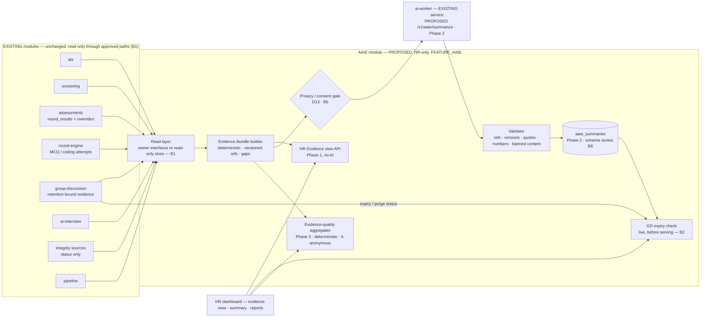

# AAIE — Anvexa Assessment Intelligence Engine

| | |
|---|---|
| **Status** | **Architecture proposal — NOT implemented.** No AAIE code, table, endpoint, prompt or UI exists. |
| **Document version** | 0.2.1 (Phase 0 architecture baseline + governance) |
| **Governance** | This README is the single source of truth for AAIE. Rules: [`.cursor/rules/aaie-docs.mdc`](../../.cursor/rules/aaie-docs.mdc). Detail of blockers B1–B3: [`ENGINEERING-DECISIONS.md`](ENGINEERING-DECISIONS.md). |
| **Owner** | Shared (docs folder); AAIE module owner to be assigned when Phase 1 is approved |
| **Applies to** | `apps/api` (proposed `aaie` module), `workers/ai-worker` (proposed endpoint, Phase 2), `apps/hr-dashboard` (proposed views), `packages/contracts` (proposed schemas) |

Labels used throughout: **[EXISTS]** implemented today and verified in code · **[PROPOSED]** design only, not built ·
**[DECIDED Dn]** approved decision · **[PENDING]** needs review · **[BLOCKER Bn]** must be resolved before the stated phase.

---

## Contents

1. [Architecture overview](#1-architecture-overview)
2. [Module ownership and data flow](#2-module-ownership-and-data-flow)
3. [Evidence sources (verified)](#3-evidence-sources-verified)
4. [Evidence references and versioning](#4-evidence-references-and-versioning)
5. [GD retention and expiry design](#5-gd-retention-and-expiry-design)
6. [Privacy and consent requirements](#6-privacy-and-consent-requirements)
7. [HR Evidence view behaviour](#7-hr-evidence-view-behaviour)
8. [Candidate Intelligence Summary (Phase 2)](#8-candidate-intelligence-summary-phase-2)
9. [Evidence-quality aggregates (Phase 3)](#9-evidence-quality-aggregates-phase-3)
10. [Database design proposal (not implemented)](#10-database-design-proposal-not-implemented)
11. [Reliability and failure semantics](#11-reliability-and-failure-semantics)
12. [Decision register](#12-decision-register)
13. [Blocker register](#13-blocker-register)
14. [Implementation roadmap](#14-implementation-roadmap)
15. [Risks](#15-risks)
16. [Acceptance criteria](#16-acceptance-criteria)
17. [Version history](#17-version-history)

---

## 1. Architecture overview

AAIE is a **separate, read-only intelligence module** [DECIDED D1]. It assembles the results and evidence that existing
modules already recorded into a **deterministic Evidence Bundle** per application, shows it to HR, and — in a later,
gated phase — produces **evidence-referenced summaries** for HR.

### What AAIE does [PROPOSED]

- Builds the Evidence Bundle through approved read paths only (§2.3).
- Gives every piece of evidence a **versioned** reference (§4).
- Reports missing, expired, unclear or failed evidence explicitly as *gaps*.
- Shows resolved evidence inline to HR (§7).
- Phase 2 (gated): generates HR summaries on demand in which every claim carries validated evidence references (§8).
- Phase 3: deterministic evidence-quality aggregates (§9).

### What AAIE never does

- Never re-scores, re-grades, changes pass/fail, overrides or pipeline stages [D2].
- Never shows anything to candidates [D3].
- Never produces a combined score, weights, rankings or percentiles [D7], or hire / no-hire statements [D8].
- Never analyses DSA / SQL code quality with AI in release 1 [D9].
- Never retains or serves expired GD evidence [D10].
- Never makes or relays integrity judgments; integrity details stay in the existing authorised HR review [D11].
- **Never overwrites, deletes, hides or replaces original evidence or existing evaluation results.** The only rows AAIE
  ever writes or deletes are its own (`aaie_summaries`, Phase 2).
- Never changes recording, speech-to-text, transcripts, stored answers, evaluators, assessment workflows or the
  existing HR evidence panels and their access.
- Never introduces new microservices, agents, queues or infrastructure: it uses the existing API process, the existing
  ai-worker (Phase 2) and the existing Postgres.

### Architecture diagram [PROPOSED]



There is deliberately **no AAIE → M27 arrow**: M27 does not exist yet; integration is deferred (B7).

---

## 2. Module ownership and data flow

### 2.1 Responsibilities (no duplication)

| Module | Owns | Audience | Writes outcomes? | Relationship with AAIE |
|---|---|---|---|---|
| Existing evaluators (ATS, screening extraction, round engine grading, DSA/SQL, GD AI + HR rubric, AI interview report) and the planned **M22 Evaluator** | Scoring, cut-offs, pass / fail with reasons | System, HR | **Yes** (through `AssessmentsService` and their own tables) | AAIE consumes their outputs; never re-scores [D2] |
| **M23 Feedback** (planned; README only) | Candidate-facing feedback / report cards | **Candidates** | No | Fully separate. AAIE shows nothing to candidates; M23 does not read AAIE output [D3] |
| **M27 Analytics** (planned; README only, event-driven in the product spec) | Company metrics: funnel, source quality, round pass rates, time-to-hire, cost, fairness checks | Company / management | No | Separate. AAIE computes only evidence-quality aggregates (§9); integration deferred until M27 exists (B7) [D4] |
| **AAIE** (proposed) | Evidence Bundle, versioned references, gaps, HR evidence view, HR summaries, evidence-quality aggregates | **HR only** in release 1 [D5] | **No** | — |

### 2.2 Module owners (from each module's README; no individual names)

| Module | Owner role as listed in its README |
|---|---|
| `ats` | Intern 2 (AI), built together with Intern 3 |
| `screening` | Intern 2 (AI) |
| `group-discussion` | M18 AI group discussion owner |
| `dsa` (incl. proctoring) | DSA assessment developer |
| `round-engine` | Intern 3 (Candidate & Comms) |
| `analytics` (M27) | Intern 1 (Core & HR) |
| `evaluator` (M22), `feedback` (M23) | Intern 2 (AI) |
| `ai-interview`, `assessments`, `pipeline` | **No owner line in the module README — to be confirmed** (part of B1) |

`.github/CODEOWNERS` covers `ats`, `screening` and `round-engine` (consistent with the README owner lines) but has
**no entry** for `ai-interview`, `group-discussion`, `dsa`, `assessments`, `pipeline`, `sql` or `docs/`. Confirming these
owners is a prerequisite for B1 and B2 (see [`ENGINEERING-DECISIONS.md`](ENGINEERING-DECISIONS.md)).

### 2.3 Cross-module read strategy [BLOCKER B1]

Verified facts:

- Public exports today (`index.ts`): `assessments` → `AssessmentsService` (incl. `resultsFor`, review);
  `pipeline` → `PipelineService`, `PipelineStore`; `round-engine` → `RoundEngineService` (`forApplication` HR view) and
  coding-state helpers. **`ats`, `screening`, `ai-interview`, `group-discussion` and `dsa` export no read services.**
- The module rule "import only through `index.ts`" governs **code imports**. The existing `assessments` store already
  reads other modules' **tables** directly through Prisma relations (`apps/api/src/modules/assessments/assessments.store.ts`
  lines 84–110: `atsEvaluation`, `screeningSession`, `roundAttempts`, `aiInterviewInvites`, `aiInterviewSessions`).

Two valid options:

| Option | Description | Pros | Cons |
|---|---|---|---|
| **A — Owner-approved public read interfaces** (recommended) | Each owner adds a small, read-only, tenant-scoped method to its `index.ts`, owns its tests, and versions its output | Ownership respected; owners control what leaves their module; schema changes stay local | Five owner changes before Phase 1 |
| B — Dedicated read-only Prisma store | AAIE has one read-only store reading owner tables, following the `assessments` precedent, with owners' written agreement on the fields read | No owner code changes; precedent exists | AAIE coupled to other modules' schemas; owner schema changes can silently break AAIE |

**Recommendation: Option A**, subject to owner agreement. Option B is the fallback per module where an owner prefers it;
either way AAIE's read layer is read-only (no write, no delete, no update on any owner table).

Required reads (names indicative, finalised in B1):

| Owner module | Read | Today |
|---|---|---|
| `assessments` | results + answers + overrides per application | **exists** (`resultsFor`, review) |
| `pipeline` | stage / verdict per application | exists (method to confirm) |
| `round-engine` | attempts per application (MCQ answers, coding state, question metadata) | partly (`forApplication`) |
| `ats` | evaluation per application | missing |
| `screening` | extraction + turn references per application | missing |
| `ai-interview` | report + turn references per application | missing |
| `group-discussion` | evaluation per application **+ evidence expiry / purge status** (B2) | missing |
| `dsa` proctoring, `round-engine`, `ai-interview` | integrity **status only** (count, terminated, HR review status) | missing |

### 2.4 Data flow [PROPOSED]

**Phase 1 — HR opens the Evidence view (no AI, nothing stored):**

1. HR opens a candidate → AAIE checks `aaie.read` + tenant.
2. The read layer fetches each source for that application (tenant-scoped).
3. The Bundle builder produces facts, versioned references and gaps; GD evidence is included only if the GD module
   reports it live and not expired (§5).
4. The view renders the resolved evidence inline (§7).

**Phase 2 — HR presses "Generate summary" (gated by D13 / B5):**

1. Build the bundle; compute `inputHash = hash(bundle content incl. every ref's source version + bundleSchemaVersion +
   promptVersion + model)`.
2. A `READY`, non-expired summary with the same hash exists → return it (no AI call) [D14].
3. Otherwise: privacy gate → claim the row (`FOR UPDATE SKIP LOCKED`, existing pattern) → ai-worker → validator →
   store.
4. Every read of a stored summary re-checks: source versions (§4.3), GD expiry live (§5), then serves or marks
   stale / expired.

No automatic or background generation in release 1 [D14].

---

## 3. Evidence sources (verified)

### 3.1 Recording, audio storage, speech-to-text and retention — per module

These three modules behave **differently**; AAIE must never describe them as one.

| | AI voice screening | AI technical interview | Group discussion |
|---|---|---|---|
| **Recording** [EXISTS] | Browser MediaRecorder per answer (`apps/careers-site/src/lib/recorder.ts`); uploaded per turn, validated in `screening.service.ts` (≤ 6 MB, audio types only) | Same pattern (`ai-interview.service.ts`) | LiveKit session; audio recorded **per speaker in chunks plus a mixed `session.webm`** |
| **Audio stored?** | **No** — bytes passed in memory to the ai-worker (`screening.prisma` header) | **No** — raw audio and video never stored (`ai_interview.prisma` header) | **Yes, on local disk** — `LocalGdAudioStorage`, `GD_STORAGE_DIR` (default `~/.hireflow/gd-recordings`), rows in `gd_recordings` |
| **Speech-to-text** | **Gemini (cloud)** via the ai-worker (`llm_gateway/gemini.py`, prompt `screening_transcribe.v1`) | **Gemini (cloud)** via the ai-worker (prompt `interview_transcribe.v1`) | **faster-whisper, local CPU** (`workers/gd-agent/gd_agent/transcribe.py`); transcripts are then sent to **Gemini** for scoring (`evaluate.py`) |
| **Transcripts stored** | `screening_turns.answer` | `ai_interview_turns.rawTranscript`, `normalizedTranscript` | `gd_transcripts.segments`; quotes in `gd_evaluations.evidence` |
| **Retention** | **No time-based purge**; deleted with the application (cascade) | **No time-based purge**; deleted with the application (cascade) | **Time-based**: `GdResultsService.retention()` (`gd-results.service.ts`) deletes audio and `gd_transcripts`, empties `gd_evaluations.evidence`, sets `gd_recordings.deletedAt` for groups that ended more than `GD_RETENTION_DAYS` (default 90) ago; scores, `feedback`, metrics and HR decisions are kept |

Note: `AiInterviewSession.recordedAt` means *"result recorded to the round engine"*, **not** a media recording. AAIE
must not treat it as recording evidence.

### 3.2 Other evidence [EXISTS]

| Source | Stored in | Usable evidence |
|---|---|---|
| ATS | `ats_evaluations` (unique per application) | score, 5-part breakdown with reasons, matched / missing skills |
| Voice screening extraction | `screening_results.extraction` | facts with turn references; **no score by design** |
| Aptitude / MCQ | `round_attempts.answers`, `round_results` | per-question correctness, marks, difficulty / topics |
| DSA / SQL | `round_attempts.codingState` (keyed by RoundQuestion id), copied into `round_results.answers` | tests passed / total, attempts, language, best submission |
| AI interview report | `ai_interview_reports.report` | 7 dimensions (null when unverified), per-answer verified quotes, skills not verified, uncertainty notes |
| GD evaluation | `gd_evaluations` | metrics, criterion scores, evidence quotes (until retention), HR rubric, `feedback` |
| HR / PI | `round_results.interviewerScore`, `notes`; `pi_calls` | number + free text |
| Integrity | `dsa_proctor_sessions`, `round_protection_incidents`, `ai_interview_violations` | used as **status only** by AAIE |
| Outcomes | `round_results` | score, pass mark, system result, HR override with reason |

### 3.3 Mutability (why references are versioned)

| Record | Can change after creation? | Mechanism |
|---|---|---|
| `round_results` | Yes | re-recording (`upsertResult`), `changePassRule` regrade, overrides |
| `ats_evaluations` | Yes | re-evaluation |
| `screening_results` | Yes | HR "retry summary" |
| `ai_interview_reports` | Yes | `retryReport` |
| `gd_evaluations` | Yes | re-evaluation, HR rubric, retention empties `evidence` |
| `screening_turns`, `ai_interview_turns` | No (append-only per `seq`) | — |
| Round questions | Frozen once the job's rounds are locked | `rounds-config.store.ts` |

---

## 4. Evidence references and versioning

### 4.1 Reference format [PROPOSED]

Every reference is a pair: **identity** + **source version**.

```ts
interface EvidenceRef {
  ref: string;            // identity, e.g. "round:{resultId}#answer/{questionId}"
  sourceVersion: string;  // "u:<sourceUpdatedAt ISO>" or "h:<contentHash>"
}
```

| Kind | Identity | Resolves to (all tenant-scoped) | Version |
|---|---|---|---|
| `ats` | `ats:{evaluationId}#part/{key}` | `ats_evaluations` → `applicationId` | `updatedAt` |
| `screening` | `screening:{sessionId}#turn/{seq}` | `screening_turns @@unique([sessionId, seq])` | content hash (turns have no update path) |
| `screening-summary` | `screening:{sessionId}#extraction/{section}` | `screening_results.extraction` | `updatedAt` |
| **`round` (canonical for every round result, incl. coding)** | `round:{resultId}#answer/{questionId}` | `round_results @@unique([applicationId, roundId])` | `updatedAt` |
| `coding` (**supplementary only**) | `coding:{attemptId}#problem/{questionId}` | `round_attempts.codingState.progress[questionId]` | content hash of that entry |
| `interview` | `interview:{reportId}#answer/{seq}` → `ai_interview_turns (sessionId, seq)`; `#dimension/{name}` | `ai_interview_reports` (unique `sessionId`) | `generatedAt` / `updatedAt` |
| `gd` | `gd:{evaluationId}#evidence/{index}`, `#score/{criterion}`, `#metrics` | `gd_evaluations` (unique `participantId`) | content hash of the cited element + **expiry status (§5)** |
| `hr-notes` | `hr-notes:{resultId}` | `round_results.notes` | `updatedAt` (GD rounds: see B4) |
| `integrity` | `integrity:{source}:{id}` | link to the existing HR review only | n/a (status only, never content) |

Rules:

- **`round:` is canonical for coding results.** `coding:` may only add detail that `round_results` does not hold
  (e.g. attempts per problem, language) and must always accompany a `round:` reference for the same question.
- Every reference resolves to `applicationId → applications (tenantId, jobId, candidateId)`; a reference from another
  tenant resolves to **not found**, never to data.
- Integrity references never carry event details into the bundle, the AI input or a summary.

### 4.2 Version source

- Prefer the owner's `updatedAt` where the row has one and every content change bumps it.
- Use a **content hash** (SHA-256 over a canonical JSON of the cited element) where there is no reliable `updatedAt`
  or where only part of a row is cited (`gd` evidence element, `coding` entry, transcript turns).
- The choice per kind is fixed in the contracts and recorded in the version history when changed (B3).

### 4.3 Stale detection

On every read of a stored summary (and on every Evidence view render):

1. Re-resolve each cited reference through the read layer.
2. Compare the current `sourceVersion` with the stored one.
3. Outcome per reference: `CURRENT` · `CHANGED` (version differs) · `MISSING` (row deleted, e.g. application erased) ·
   `EXPIRED` (GD, §5).
4. Summary status: all `CURRENT` → serve; any `CHANGED` / `MISSING` → serve with a **"Stale — evidence changed,
   regenerate"** banner and mark affected statements; any `EXPIRED` → **do not serve** (§5).

The bundle `inputHash` includes every `sourceVersion`, so regeneration after a change never reuses the old summary.

---

## 5. GD retention and expiry design

### 5.1 Verified current behaviour [EXISTS]

- No stored expiry. `retention()` computes `endedAt < now − GD_RETENTION_DAYS` at sweep time
  (`gd-results.service.ts`); `GD_RETENTION_DAYS` is configurable (1–3650, default 90) and its config is not exported.
- The GD worker runs the sweep roughly hourly and processes at most 20 groups per run, so actual deletion can lag
  behind nominal expiry.
- Deleted: audio files, `gd_transcripts`, `gd_evaluations.evidence` (set to `[]`), `gd_recordings.deletedAt` set.
  Kept: scores, metrics, `feedback`, HR decisions; the GD result's `round_results.notes` (rubric remarks or AI feedback).

### 5.2 Design [PROPOSED; depends on B2]

1. **The GD module is the only authority on expiry.** It exposes (B2) a read such as
   `gdEvidenceStatus(tenantId, applicationId) → { endedAt, nominalExpiry, purged }`, computed with the GD module's own
   retention configuration.
   **Expired = `now ≥ nominalExpiry` OR `purged`** — so a shortened retention setting or a lagging sweep can never make
   AAIE serve evidence the GD module considers gone.
2. **Evidence view and bundle**: expired GD evidence is never fetched or shown; it appears as a gap
   `EXPIRED (GD retention)`. GD scores, metrics and decisions, which the GD module itself keeps, may still be shown.
3. **Live check before serving any stored summary that cites `gd:` references.** If expired: the summary is **not
   served**; HR sees "This summary cited group-discussion evidence that has passed its retention period. Regenerate."
4. **All versions.** `aaie_summaries` may hold several rows per application (history). The expiry check and deletion
   apply to **every** row citing the expired evidence, not only the latest.
5. **Delete-on-read**: the request that finds an expired summary deletes every affected row in the same transaction and
   writes an audit entry `aaie.summary_deleted_expired` (metadata: summary ids, application id, reason
   `GD_RETENTION`; never summary text). Concurrent readers are safe: deletion is idempotent (`deleteMany` by id).
6. **Sweep (index only)**: `evidence_expires_at` (the earliest nominal GD expiry cited) is stored only so a daily AAIE
   sweep can find and delete expired rows nobody opened. It is **never** the authority for serving — the live check is.
7. **Quotes**: a summary may quote GD evidence only while it is live; because expired summaries are deleted entirely,
   no GD quote text survives in AAIE beyond retention [D10].
8. **Regeneration**: after expiry the bundle marks GD quotes `EXPIRED`, the `inputHash` changes, and HR can generate a
   new summary that relies only on retained GD data (scores, decisions).

### 5.3 GD-derived text that survives retention [BLOCKER B4 — unresolved]

The GD module keeps `gd_evaluations.feedback` (AI-written, 2–4 sentences) and writes GD rubric remarks or AI feedback
into `round_results.notes` for GD rounds. These outlive the transcript and quotes. **AAIE does not decide whether this
text may be cited after GD retention.** Until B4 is decided, AAIE treats it as **GD evidence subject to the same expiry**
(the conservative default: not shown or cited after expiry) — this is a temporary safeguard, not a policy decision.

---

## 6. Privacy and consent requirements

### 6.1 Existing third-party processing [EXISTS]

- Voice screening and AI interview **audio** is sent to the **Gemini API** for transcription and turn decisions.
- GD **transcripts** (transcribed locally) are sent to the **Gemini API** for scoring.
- AAIE Phase 2 would add: **summaries of existing assessment evidence**, generated by the Gemini API.

### 6.2 Requirements before any AI summarization [DECIDED D13 · BLOCKER B5]

1. Confirm the candidate notices / consent texts cover AI-assisted summarisation of assessment evidence for HR, and
   the existing Gemini processing listed above (data controller / processor terms, data location, retention by the
   provider, use for model training).
2. Record the approval (who reviewed, date, consent version) in this document's decision register.
3. Server switch `AAIE_AI_SUMMARIES` defaults to **off**; turning it on requires the recorded approval.
4. Summaries are only generated for applications whose recorded consent version is at least the approved one.

### 6.3 Data minimisation (Phase 2) [PROPOSED]

- AI input contains pseudonymous ids only — no name, email, phone or college.
- Only bundle facts and quotes; never audio, never integrity details.
- Candidate text (transcripts, code, SQL) is wrapped as untrusted data (prompt-injection defence).

### 6.4 Access, audit, erasure [PROPOSED]

- Permissions `aaie.read`, `aaie.generate` (Company Admin, HR Member) in the existing matrix; HR-only [D5].
- Every read is tenant-scoped through `TenantContext`; another company's ids return 404.
- Audit: `aaie.summary_generated`, `aaie.summary_failed`, `aaie.summary_deleted_expired` — ids, versions and hashes
  only, never content (audit rows survive erasure).
- `aaie_summaries` cascades with the application; AAIE keeps no other copy of evidence.

---

## 7. HR Evidence view behaviour

[PROPOSED — Phase 1, no AI, nothing stored]

- Placement (pending U8): a tab on the existing student review page (`/assessments/[applicationId]`).
- **Evidence is resolved and rendered inline** in the view: answers, scores, quotes, transcript turns, test results.
  **No reliance on deep links or anchors** into existing panels (none exist for individual turns or answers).
- Each item shows its source, time, and status: `CURRENT`, `CHANGED`, `EXPIRED`, `MISSING`.
- A "Gaps and limitations" section lists every gap: not attempted, expired (GD retention), unclear transcript, report
  failed, round run by HR without structured evidence, **source temporarily unavailable**.
- Integrity: a status line and a link to the existing proctoring review (which keeps its own permission checks); no
  details are copied.
- Existing HR panels (`ai-screening-panel`, `ai-interview-panel`, `online-test-panel`, GD results) are unchanged and
  remain the primary place for HR actions (decisions, overrides, reviews). The Evidence view is read-only.

---

## 8. Candidate Intelligence Summary (Phase 2)

[PROPOSED — gated by D13 / B5 and B6]

Sections: executive summary · competency evidence side by side (no combined score, no weights; taxonomy U5) ·
strengths · improvement areas · technical observations · interview observations · **areas to probe in the next
interview** · evidence references · missing information and limitations · integrity link only · provenance.

### Validation (every generated output)

1. Every statement carries ≥ 1 `EvidenceRef`.
2. Every ref exists in the exact bundle (same `inputHash`) with the same `sourceVersion`.
3. Every quotation is an exact substring (whitespace-normalised) of the referenced bundle text.
4. Every number equals a value recorded in a cited reference; no derived or converted numbers.
5. Banned: composite scores, weights, rankings, percentiles, hire / no-hire wording, integrity details, personal
   identifiers, personality or emotion claims, citing expired GD evidence.
6. One regeneration on failure, then `FAILED`; HR keeps the deterministic Evidence view. Unvalidated text is never
   stored or shown.

The Hiring Manager Summary is **deferred** (HR-only release) [D5].

---

## 9. Evidence-quality aggregates (Phase 3)

[PROPOSED — deterministic, HR-only, k-anonymous]

Limited to **evidence quality**, which only AAIE computes:

- evidence completeness per round (share of attempts with usable evidence);
- frequency of each gap type (expired, unclear transcript, report failed, HR-run without structure, source unavailable);
- frequency of "skills not verified" in AI interview reports.

Excluded: funnel, pass rates, **override frequency**, time-to-hire, source quality, fairness checks — these belong to
M27 / `assessments`. Groups smaller than k (proposed 5, U6) are suppressed. Exposed only as AAIE's own `index.ts` read
method; **M27 integration deferred until M27 exists** (B7).

---

## 10. Database design proposal (not implemented)

[PROPOSED — Phase 2 — schema review required (B6). No migration exists.]

`aaie_summaries` (only AAIE table):

| Column | Type | Purpose |
|---|---|---|
| `id` | uuid | |
| `tenant_id` | uuid | isolation |
| `application_id` | uuid FK → applications, `ON DELETE CASCADE` | erasure |
| `job_id` | uuid | listing |
| `kind` | enum (`CANDIDATE`) | audience (release 1: HR candidate summary only) |
| `status` | enum (`PENDING`, `RUNNING`, `READY`, `FAILED`) | generation state |
| `attempts`, `last_error`, `locked_at` | int, text, timestamptz | retries, claims |
| `input_hash` | text | reuse [D14] |
| `bundle_schema_version`, `aaie_version`, `prompt_version`, `model` | text | traceability |
| `summary` | jsonb | validated statements with refs (may contain quotes, incl. GD quotes **only while live**) |
| `cited_sources` | jsonb | `[{ ref, sourceVersion }]` for stale detection |
| `evidence_expires_at` | timestamptz null | earliest nominal GD expiry cited — **sweep index only** |
| `generated_by_id` | uuid | accountability |
| `created_at`, `updated_at` | timestamptz | |

Indexes: `(tenant_id, application_id, created_at)`, `(input_hash)`, `(evidence_expires_at) WHERE NOT NULL`.
Multiple rows per application are allowed (history); expiry and deletion apply to every row (§5.2).

---

## 11. Reliability and failure semantics

- **Infrastructure failures are never candidate failures.** A source that cannot be read (timeout, owner error,
  database issue) becomes the gap `SOURCE_UNAVAILABLE`, shown as a technical issue. It is never shown or summarised as
  "not attempted", "failed" or "missing evidence from the candidate".
- AI unavailable (Phase 2): the summary is `FAILED` with a technical reason; the Evidence view keeps working.
- Validation failure: one regeneration, then `FAILED`; never partial or unvalidated output.
- Claims use the existing `FOR UPDATE SKIP LOCKED` pattern; stale locks (> 10 min) are reclaimed.
- AAIE never retries by writing to owner modules and never triggers owners' retries (e.g. it does not call
  `retryReport`); HR uses the existing panels for that.
- Cost guard: `inputHash` reuse, per-tenant daily cap (U6), bounded bundle size.

---

## 12. Decision register

| # | Decision | Status |
|---|---|---|
| D1 | AAIE is a separate intelligence module | Approved |
| D2 | Existing evaluators / M22 stay separate; AAIE never re-scores or re-grades | Approved |
| D3 | M23 candidate feedback stays separate; no candidate-facing AAIE output | Approved |
| D4 | M27 owns company analytics; AAIE limited to evidence-quality aggregates; integration deferred | Approved (integration **pending**, B7) |
| D5 | HR-only access in release 1 | Approved |
| D6 | One versioned `aaie_summaries` table | **Pending** schema review (B6) |
| D7 | No combined score, weights, rankings or percentiles | Approved |
| D8 | Only evidence-based observations and areas to probe | Approved |
| D9 | No AI DSA / SQL code-quality analysis in release 1 | Approved |
| D10 | Expired GD evidence never retained or served | Approved (mechanism **pending** B2; GD-derived text **pending** B4) |
| D11 | Integrity details only in authorised HR review; no AI integrity judgments | Approved |
| D12 | Aggregates deterministic in release 1 | Approved |
| D13 | Privacy and consent verified before AI summarisation | Approved as a gate; verification **pending** (B5) |
| D14 | On-demand generation with input-hash reuse | Approved |

Other open decisions: **U4** aggregates visible to Company Admins only or also HR Members · **U5** competency taxonomy
(no weights either way) · **U6** daily generation cap and k-anonymity threshold (proposed 5) · **U8** Evidence view
placement.

---

## 13. Blocker register

| # | Blocker | Blocks | Status |
|---|---|---|---|
| B1 | Cross-module read approach + agreement from five owners | **Phase 1** | OPEN — detail in [`ENGINEERING-DECISIONS.md`](ENGINEERING-DECISIONS.md) |
| B2 | GD expiry / purge status interface | **Phase 1** (GD section of the bundle) | OPEN — detail in [`ENGINEERING-DECISIONS.md`](ENGINEERING-DECISIONS.md) |
| B3 | Source reference versioning scheme | **Phase 1** | OPEN — detail in [`ENGINEERING-DECISIONS.md`](ENGINEERING-DECISIONS.md) |
| B4 | Policy for GD-derived text surviving retention | Phase 2 | Open (conservative default in §5.3) |
| B5 | Privacy and consent verification incl. Gemini processing | Phase 2 | Open |
| B6 | `aaie_summaries` schema review | Phase 2 | Open |
| B7 | M27 integration design | Phase 3 integration only | Deferred until M27 exists |

### B1 — Cross-module read approach

- **Decision required:** Option A (owner public read interfaces) or Option B (AAIE read-only store), per module.
- **Recommended:** Option A; Option B only where an owner explicitly prefers it in writing.
- **Responsible:** owners of `ats`, `screening`, `ai-interview`, `group-discussion`, `dsa` (five modules without
  read exports); confirmation from `assessments`, `pipeline`, `round-engine` owners that their existing exports may be
  used. Owners of `ai-interview`, `assessments`, `pipeline` must first be confirmed (no owner line in their READMEs).
- **Acceptance criteria:** for each of the five modules: the read signature, returned fields and version field are
  written into this document and agreed by the module owner; each read is tenant-scoped, read-only and covered by the
  owner's tests (or, for Option B, the exact fields AAIE may read are listed and agreed).
- **Blocks:** Phase 1 (not Phase 0).

### B2 — GD expiry / purge status interface

- **Decision required:** the GD module exposes evidence status per application.
- **Recommended:** `gdEvidenceStatus(tenantId, applicationId) → { endedAt, nominalExpiry, purged }`, computed with
  the GD module's own retention configuration; AAIE treats `now ≥ nominalExpiry OR purged` as expired.
- **Responsible:** `group-discussion` module owner (M18).
- **Acceptance criteria:** the interface is agreed and documented here; it returns `purged = true` once the sweep ran
  and expiry is reported even if the sweep has not run yet; a shortened `GD_RETENTION_DAYS` is reflected immediately;
  tenant-scoped; owner tests cover ended / not ended / expired-not-swept / purged.
- **Blocks:** Phase 1 (GD part of the bundle). Phase 1 may ship without GD evidence if B2 is not ready.

### B3 — Source reference versioning scheme

- **Decision required:** the version field per reference kind (`updatedAt` vs content hash) and the canonical-JSON
  hashing rule.
- **Recommended:** the table in §4.1 — `updatedAt` for whole-row sources that bump it on every change; SHA-256 of a
  canonical JSON for partial elements (GD evidence item, coding entry, transcript turn).
- **Responsible:** AAIE module (proposer) with each source owner confirming that `updatedAt` changes on every content
  change of their rows.
- **Acceptance criteria:** every reference kind in §4.1 has an agreed version source; owners confirm `updatedAt`
  behaviour or a hash is used instead; stale detection outcomes (§4.3) are specified with test cases.
- **Blocks:** Phase 1.

### B4 — GD-derived text surviving retention

- **Decision required:** may AAIE show / cite `gd_evaluations.feedback` and GD `round_results.notes` after GD
  retention?
- **Responsible:** product / data-protection decision with the `group-discussion` owner.
- **Until decided:** treated as expiring GD evidence (§5.3).

### B5 — Privacy and consent verification

- **Decision required:** confirmation that notices and consent cover AI summarisation and the existing Gemini
  processing (§6).
- **Responsible:** the person or role accountable for data protection (to be named by the company), with the product
  owner.

### B6 — Database schema review

- **Decision required:** approve §10 (`cited_sources`, `evidence_expires_at` index, multi-row history, deletion
  semantics).
- **Responsible:** API / database maintainers.

### B7 — Future M27 integration

- **Decision required:** when M27 exists, pull (AAIE read method) or events; which evidence-quality metrics it shows.
- **Responsible:** `analytics` (M27) owner.

---

## 14. Implementation roadmap

| Phase | Scope | AI | New table | Entry gate |
|---|---|---|---|---|
| **0 — Architecture baseline** (this document) | Decisions, blockers, designs; owner alignment for B1–B3 | No | No | — |
| **1 — Evidence Bundle + HR Evidence view** | Contracts (`EvidenceRef`, bundle, gaps); owner read interfaces; AAIE read layer, bundle builder, versioned refs, stale detection, GD live expiry; `aaie.read`; inline Evidence view | **No** | **No** | B1, B2 (or ship without GD), B3 resolved; explicit approval |
| **2 — Candidate Intelligence Summary** | ai-worker endpoint + prompt, validator, `aaie_summaries`, on-demand generation, delete-on-read + sweep, audit, `aaie.generate` | Yes | `aaie_summaries` | B4, B5, B6 resolved; explicit approval |
| **3 — Evidence-quality aggregates** | Deterministic, HR-only, k-anonymous; AAIE `index.ts` read method | No | No | U4, U6; explicit approval |
| **Deferred** | Hiring Manager Summary + access; management role; AI narrative for aggregates; DSA / SQL code-quality analysis (D9); automatic generation; M27 integration (B7) | — | — | separate decisions |

Each phase ends with this document updated (sections + version history).

---

## 15. Risks

| Risk | Mitigation |
|---|---|
| AI overreach / hallucination | refs on every claim; version, quote, number validation; banned content; deterministic fallback |
| Bias | no identifiers or college to AI; no scores / rankings / percentiles; integrity excluded |
| Duplicating M22 / M23 / M27 | §2.1 responsibilities; aggregates limited to evidence quality |
| Ownership friction | Option A interfaces owned by owners; Option B only by written agreement |
| Expired GD evidence served | live GD status check (B2); delete-on-read across all rows; sweep as backup |
| Stale summaries after re-grading / regenerated reports | versioned refs and stale banner (§4.3) |
| Infrastructure failure read as candidate failure | `SOURCE_UNAVAILABLE` gap, separate wording (§11) |
| Third-party AI processing | consent gate, minimisation, pseudonymisation (§6) |
| Aggregate performance | per-application reads in Phase 3; owner aggregate reads only if needed |

---

## 16. Acceptance criteria

Phase 0 (this document):

- [x] All nine verification corrections reflected (§3.1, §4, §5, §2.3, §7, §9, §6.1).
- [x] D1–D14 recorded with accurate status; pending items marked.
- [x] B1–B7 recorded; B1–B3 with decision, recommendation, responsible module, acceptance criteria, phase.
- [x] No code, schema, migration or workflow changes.

Phase 1 (to be confirmed at approval):

- No write to any owner table; owner modules' tests unchanged and passing.
- Every evidence item resolves tenant-scoped to its application; cross-tenant ids return not found (tests).
- Stale detection: `CURRENT` / `CHANGED` / `MISSING` / `EXPIRED` covered by tests.
- GD: expired-but-not-swept and purged evidence never shown (tests).
- Source failures shown as `SOURCE_UNAVAILABLE`, never as candidate gaps (tests).
- Existing HR panels, recording, STT, transcripts and evaluators unchanged.

---

## 17. Version history

| Version | Date | Change |
|---|---|---|
| 0.1.0 | 2026-11-11 | Stage 1 architecture proposal and revision (in review conversation; not committed as a file) |
| 0.2.0 | 2026-11-11 | Phase 0 baseline: first version of this document. Applied the nine verification corrections (versioned refs; `round:` canonical; GD live expiry, all versions, audited delete-on-read; GD-derived text recorded as B4; override frequency removed, M27 deferred; two cross-module read options, A recommended; inline Evidence view; per-module recording / STT / retention; Gemini processing in privacy review). Decision register D1–D14 and blocker register B1–B7. |
| 0.2.1 | 2026-11-11 | Phase 0 governance: added `.cursor/rules/aaie-docs.mdc` (this README is the single source of truth) and `ENGINEERING-DECISIONS.md` (B1–B3 detail, all OPEN). Recorded `.github/CODEOWNERS` coverage gaps (§2.2). No decision status changed; D1–D14 unchanged. |
